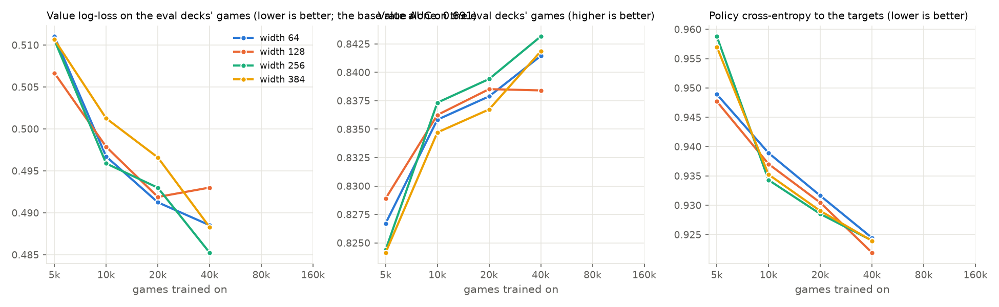
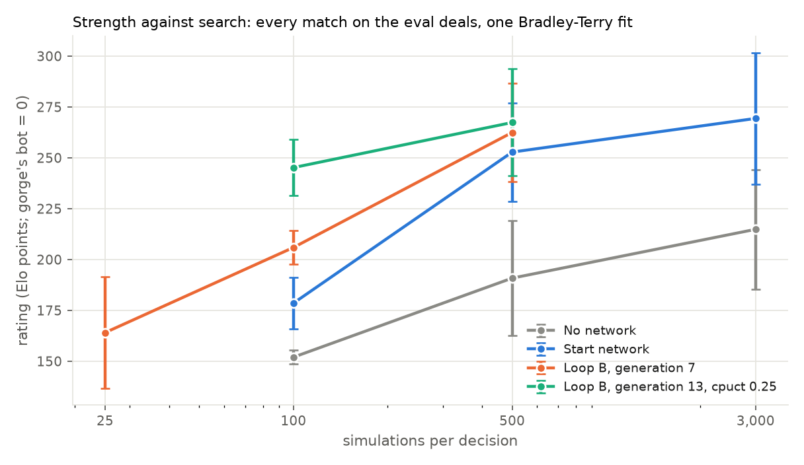

# Searching for a self-play recipe that scales: laptop experiments on gorge

*Status (Monday 12 October 2026, 2:30 AM PT): stage 0, E1 and E2 done (§6); E3's loops running on r1, the search ladder on
Dan's laptop (an 8-core M1 Pro). The code is on the
[`gorge-train`](https://github.com/danieljbrooks/draft-zero/tree/gorge-train) branch (`gorge/recipe/`).*

**The goal (Dan, 11 October): find a recipe that keeps getting better on millions of games,** not just the best bot
a laptop can train in a day. A laptop plays about 10^5 cheap games a day, so each experiment here measures a *slope*:
how strength and value quality grow with games, per recipe, at equal compute. The recipe whose curve is still rising
gets the long run on r1 or pods, as the draft plan [docs/030](030-gorge-rl-plan.md) (uncommitted, another session's)
lays out.

Terms, as in docs/027:
- A **search** at N **simulations** plays N short look-ahead lines before each decision.
- The **full search** is gorge's search with our patches 0002-0007: casts, modes, choices, multiple targets and the
  opponent's decisions in the tree.
- A **policy** says which moves to try first, a **value** the chance of winning.
- **Cheap games** run the search at 25 simulations and record one searched decision in four.
- **Paired games** play each deck pair twice with the seats swapped.
- A **generation** is one round of self-play followed by training the next network.

## 1. What we start from

| Result | Source |
|---|---|
| Best bot so far: the full search at 100 simulations with a width-64 MLP (0.6M parameters) inside the engine, trained on 50 minutes of its own cheap games: 58.2% of 600 paired games against the full search without a network, 62.2% of 1,400 against the original plain search | docs/027 §4.5 |
| Its loop of cheap games (C1, C2) gained a little per generation; generation 3 never ran (r1 closed). The networks were lost with the machines | docs/027 §4.7 |
| Games, not positions, limit the value; the value's held-out loss stopped improving near 30,000 games, for every network tried | docs/027 §6 |
| Visit counts at 100 simulations over ≤6 candidates teach the policy little; completed-Q targets with a blended value target (loop B) kept improving where visits with the result (loop A) stalled | docs/027 §4.2 |
| The value carries most of the gain with search; λ ≈ 0.99 blends; judge a recipe over at least two generations | docs/029 |

## 2. How a recipe is judged

Every network is scored three ways, at fixed settings, so curves are comparable across experiments:

| Measure | How | Cost on the laptop |
|---|---|---|
| **Strength** | the full search at 100 simulations with the network, against the full search without one (the **zero point**), 500 deck pairs (1,000 paired games) on the eval decks, seed 3131 | ~20-30 minutes |
| **Value quality** | held-out log-loss and AUC on 600 cheap games on the eval decks (never trained on) | seconds |
| **The policy alone** | the network's top move, no search, against gorge's bot | ~5 minutes |
| **Against a fixed baseline** (added Sunday 8 AM, Dan) | the full search at 100 simulations with the network against gorge's heuristic bot, which never changes: 500 deck pairs (1,000 games), every generation | ~20-30 minutes |
| **The search ladder** (added Sunday 8 AM, Dan) | the best kind of network inside the full search at 100, 500 and 3,000 simulations against gorge's bot, beside the search without a network at the same simulations: 200 games a level (100 deck pairs; one standard error about 3 points), enough to see whether strength still rises | one level between generations |

The zero point moves with the engine's search; the bot is the absolute yardstick, so every generation's number against it is comparable across experiments and days. The ladder shows how a recipe's network scales with search: whether its gain over the search without it grows, holds or vanishes as simulations rise, and where more search stops helping.

Promising networks also play the previous best head to head. At 1,000 paired games about 3 points is within chance.
Single matches mislead, so a recipe's verdict rests on its *curve*: several points along games or generations.

## 3. The experiments

Ordered, each answering one question. After each, the run log (§6) records the hypothesis, the result and the next
step: extend a run, or start a new one.

**E1. Does a bigger network keep learning from more games?** *(offline: minutes per arm)*
- **Data:** stage 0's games, the full search without a network, cheap: 40,000 games, extended later.
- **Arms:** MLPs of four sizes (width 64 / 128 / 256 / 384, 0.6M to ~5M parameters), each trained on 5k, 10k, 20k
  and 40k games.
- **Read:** held-out value loss and policy cross-entropy against games, one line per size. If the wider networks
  keep falling where width 64 flattens, the 30,000-game plateau was capacity; if every size flattens together, it is
  the game's luck, and gains must come from search and targets.
- **Then:** the best two sizes play the strength match. The engine's cost of a wider network is part of the verdict:
  a network has to beat the zero point at equal time, not only at equal simulations.

**E2. Which targets?** *(offline on the same games)*
- **Arms:**
  - policy target: visit counts, or completed-Q at two strengths (gorge's `cq`, the counterpart of docs/029's
    Q-tilted target);
  - value target: the result alone, or blended with the search's root value (0.3, 0.5).
- **Read:** held-out losses, then the strength match for the best two.

**E3. The loop** *(the main event)*
- **Each generation:**
  - cheap self-play with the previous network inside the search (in-engine MLP, the prior choosing the candidates);
  - the next network trains on a window of recent games;
  - every generation gets the strength match and a head-to-head against the previous one.
- **Recipes, at equal laptop compute:**

| Loop | Network | Training | Window |
|---|---|---|---|
| **A** (docs/027's cheap-games loop, the control) | width 64, fixed | from scratch each generation | every game so far |
| **B** (grow) | width chosen by E1, grown when E1's curves say so | warm start from the last generation | every game so far |
| **C** (more search in self-play) | as B | as B | as B, with self-play at 50 simulations instead of 25 (fewer, better games) |

  The targets are E2's winners for all three.
- **Read:**
  - strength and value loss against total games, per loop;
  - each generation's step over the last.

  The recipe for millions of games is the loop whose curve is still rising at the end, not the one with the
  highest single point.

**E4. Extend the best loop** for as long as it keeps rising, with paired games every generation. Re-check E1's
question on the bigger data as it accumulates: does a wider network now pull ahead?

**Ideas held back for later rounds,** run if the loops stall:
- policy-surprise weighting (KataGo);
- auxiliary targets (life totals, turns left);
- Gumbel root selection at low simulations (docs/030's stage 0, engine work);
- a value-only network beside the policy;
- more candidates (`topk`) as the prior improves.

## 4. Laptop budget

Measured on the laptop (8 cores, M1 Pro):

| Work | Speed |
|---|---|
| Cheap self-play, full search, no network | ~22,000 games an hour (7 workers) |
| The 100-simulation strength match, no network on either side | ~4,500 games an hour |
| With the in-engine MLP | to measure (docs/027: about 2× slower) |
| Training a width-64 MLP | to measure (MPS; docs/027's took minutes on a GPU) |

A day is roughly:
- 100,000-200,000 cheap games;
- a few dozen trainings;
- 20-30 strength matches.

Every job runs under `caffeinate` and `nohup` with a hard time limit, so it survives the app closing (the laptop
sleeping paused docs/029's watchers for hours). The disk has ~15 GB free; a cheap game's records take ~9 KB.

## 5. What would change the plan

| If | Then |
|---|---|
| Every network size flattens at the same number of games (E1) | Scale games and search, not network size; put E3's compute into more games per generation |
| Wider networks keep improving but cost too much inside the engine | The recipe for millions of games includes a faster network path (docs/030 stage 0: incremental encoding, batching) |
| Loop A keeps up with B and C | The simplest recipe scales; prefer it |
| A loop beats its predecessor but not the zero point | Self-play overfitting to itself: add past networks as opponents |

## 6. Run log

*Appended as results come in. Times are Pacific.*

### Stage 0: the games (Sunday 12:10-2:15 AM)

- **Held-out games:** 600 cheap games on the eval decks, 9,392 recorded decisions. Every value and policy number below
  is measured on these (never trained on).
- **Training games:** 40,000 cheap games on the train decks, the full search without a network, in 1 hour 50 minutes
  on 7 cores (about 22,000 an hour). 641,027 recorded decisions, 16 per game.
- **Storage:** a packed game took 112 KB, almost all of it the per-card features in 32-bit floats. Stored as 16-bit
  (`gorge/recipe/shrink.py`; training reads them back unchanged, the same losses to four decimals) it takes 72 KB. The
  laptop has about 12 GB free, so a loop keeps at most ~150,000 games packed at once.
- **Training is cheap; games are not.** An MLP trains at about 10,000 decisions a second on the laptop's GPU. Every
  E1 arm took 1-6 minutes, against 2 hours for the games, so the recipe question is how much each game teaches.

### E1: network width against games (Sunday 2:15-3:10 AM)

*Hypothesis: docs/027's value plateau near 30,000 games was the width-64 network's capacity, and wider networks keep
improving.*

Sixteen MLPs (widths 64, 128, 256 and 384; 0.6M to 6.3M parameters), each trained on stage 0's first 5k, 10k, 20k
or 40k games with loop B's targets (completed-Q at 0.03, value half result and half the search's estimate), up to 8
passes with early stopping.

| Games | Value log-loss, width 64 / 128 / 256 / 384 | Value AUC, best width |
|---|---|---|
| 5k | 0.511 / 0.507 / 0.511 / 0.511 | 0.829 |
| 10k | 0.497 / 0.498 / 0.496 / 0.501 | 0.837 |
| 20k | 0.491 / 0.492 / 0.493 / 0.497 | 0.839 |
| 40k | 0.489 / 0.493 / 0.485 / 0.488 | 0.843 |

*The value's log-loss is against the game's result on the held-out games; predicting the base rate alone scores
0.691.*

- **Width doesn't matter at these sizes.** At every game count the four widths are within about 0.005, close to the
  held-out set's noise (600 games).
- **The value still improves from 20k to 40k games, but slowly:** about 0.003-0.008 per doubling, against 0.014 from
  5k to 10k. The policy's fit keeps falling evenly with each doubling.
- **Every arm stopped early,** most after 3-5 passes: a network memorises the games it has seen. Small networks
  overfit as fast as big ones.

- **Strength:** the width-64 network on 40k games won only **51.7% ± 1.1 of 1,000** paired games against the zero
  point, short of docs/027's 56-58%. E2 found why: the policy target.

*Reading (E1 used loop B's targets, which E2 replaces; the 80k point in E2 is with the better ones): the plateau is
the data's, not capacity. A cheap game's value labels are mostly luck (one result per
16 decisions), so more of the same games buys little. What remains to test: whether better games (a network in the
search, E3) or better labels (E2) move the curve more than more games do.*

### E2: which targets (Sunday 3:10-5:45 AM)

*Hypothesis: loop B's targets (docs/027 §4.2) are the right default: completed-Q for the policy, the value half
result and half the search's estimate.*

Width-128 MLPs on stage 0's first 40k games, with six target pairs; then the strength match (§2) for three of them.

| Policy target | Value target | Value log-loss | Value AUC | Strength (1,000 paired games) |
|---|---|---|---|---|
| Visit counts | result | **0.473** | **0.853** | **55.2%** |
| Visit counts | half result, half the search's estimate | 0.487 | 0.842 | |
| Completed-Q 0.03 | result | 0.473 | 0.851 | 51.7% |
| Completed-Q 0.03 | 30% the search's estimate | 0.476 | 0.850 | |
| Completed-Q 0.03 | half and half (width 64, E1) | 0.489 | 0.841 | 51.7% |
| Completed-Q 0.1 | half and half | 0.490 | 0.840 | |
| Completed-Q 0.01 | half and half | 0.489 | 0.842 | |

*Strength: the full search at 100 simulations with the network inside the engine against the same search without
one (the zero point), 500 deck pairs on the eval decks. One standard error is about 1.1 points; the three matches
share their deals.*

- **Loop B's targets are not the right default here.** Docs/027's best network (56.3% of 1,400 in its final check)
  used visit counts and the result; with completed-Q the same games give 51.7%, whichever the value target.
- **The value's label: the result alone.** Blending in the search's root estimate makes a worse value (log-loss
  0.487-0.490 against 0.473; AUC 0.842 against 0.853). Without a network that estimate is the heuristic's, weaker
  than the game's result.
- **The policy's label: visit counts, in games.** Completed-Q fits its own target more closely (cross-entropy 0.93
  against 1.04 for visits; the uniform guess is 1.05), and the values are equal, yet it plays 3.5 points worse. The
  prior chooses which 6 moves the search considers (`topk=6`), and at 25 simulations completed-Q follows noisy
  estimates; a prior that is sharp and wrong drops good moves before the search sees them. Visit counts at 25
  simulations stay close to the heuristic's spread.
- **Regularising the value** (width 128, visits + result): weight decay 0.1 gives 0.4735, dropout 0.2 0.4747, a
  learning rate of 3e-4 instead of 1e-3 **0.4684** (against 0.4726). The loops use 3e-4.
- **The value overfits after about one pass** with the result as its label (best after 0.75-1.75 passes, against
  3-6 with the blended label): the networks learn each game's luck once they see it twice. More games is the remedy,
  which suits a recipe for millions of games.
- **80,000 games** (stage 0 extended by 40,000 games on the same decks, Sunday 2:15-5:25 AM), width 64, visits +
  result: value log-loss **0.4636**, AUC 0.859, against 0.4700 and 0.853 at 40,000. Still improving with each doubling
  (about 0.006), unlike docs/027's plateau.

*Next: E3, the loops, with visit counts and the result as targets, starting from the 55.2% network.*

### Running into hangs (Sunday 6 AM-1 PM)

Three faults cost most of the morning; each is fixed in `gorge/recipe/` and gorge patch 0008.

- **A hung game held every later one.** A game with the network in the search sat on one decision for over an hour.
  `dzgorge` writes games in order, so every game finished after it waited in memory: 4,960 of generation 1's games, and
  later the rest of two matches. The decision had 388 options, and the network's top-6 ranking encoded all 388 at every
  simulation that reached it. **Patch 0008** (`-topk-max-options 64`) skips the ranking at a decision with more than 64
  options (the bot's answer first, then enumeration order, a uniform prior, as with no network). Recorded decisions
  almost never have more than 40 options, so normal play is unchanged; the game that had hung for over 40 minutes plays
  in 20 seconds.
- **The time limit never fired.** Every `dzgorge` job ran under an alarm signal, which Go programs catch and ignore. The
  limit now sends TERM, then KILL, and every match and self-play run goes in chunks of deck pairs with a limit each:
  a hung game costs one chunk's time and one skipped pair, not the run.
- **A shell quirk trained one generation on nothing.** macOS's bash 3.2 returns an empty list for "the last 20" of a
  shorter list; both loops' generation 1 skipped training until the slice was rewritten.

Generation 1's self-play skipped one game (3,040, the hung one); loop A's first strength match on the laptop lost 63
pairs to it and was rerun in full on r1.

### E3: the loops (from Sunday 1 PM, on r1)

r1 came back on Sunday afternoon: 30 cores, 80 GiB, two GPUs. The loops moved there (30 workers; a generation of 8,000
games with the network in the search takes about 15 minutes, its training a few, its two matches about 15); the laptop
runs the search ladder.

*Hypothesis: a loop's networks keep improving on their own games; warm-starting (B) gets there for less training than
starting over (A).*

- **Both loops:** start from E2's network (visit counts and the result; 55.2% against the zero point), 8,000 games a
  generation with the previous network inside the search (25 simulations, the prior choosing 6 candidates), trained
  on stage 0's 80,000 games plus every generation's so far.
- **A** trains a fresh width-128 network each generation (learning rate 3e-4, early stopping); **B** continues the
  previous one for one pass at 1e-4.
- **Each generation plays two matches:** 400 deck pairs (800 games) against the zero point, and 500 pairs (1,000 games)
  against gorge's bot, both at 100 simulations, on the same eval deals every time.

| Generation | Games so far (with a network) | A: against the zero point | A: against the bot | B: against the zero point | B: against the bot |
|---|---|---|---|---|---|
| 0 | 0 | 55.2% | | 55.2% | |
| 1 | 8,000 | 55.9% | 75.5% | 55.9% | 74.5% |
| 2 | 16,000 | 57.2% | 76.4% | 56.4% | 73.4% |
| 3 | 24,000 | 55.1% | 76.0% | 57.1% | 75.6% |
| 4 | 32,000 | 56.5% | 74.6% | 57.4% | 74.1% |

*One standard error is about 1.3 points against the zero point and 1.2 against the bot. Generation 1's games are shared
by both loops (the same start network played them).*

- **Loop D** (from Sunday 4:20 PM) tests whether the stage-0 games dilute the loops: it branches from loop A at
  generation 3 and trains from scratch on its last 4 generations only (32,000 games, no stage-0 games). Its generation 4
  won 54.9% against the zero point and 74.5% against the bot.

*Four generations in, no loop has moved beyond chance: every network is at 55-57% against the zero point and 73-76%
against the bot.*

**Is anything learning?** Every generation's network scored on the held-out games of the newest generation (12,666
decisions from loop B's and D's generation 4, games no network trained on):

| Network | Value log-loss | Value AUC | Policy cross-entropy (uniform 1.045) | Agrees with the search's top move |
|---|---|---|---|---|
| Start | 0.449 | 0.870 | 1.027 | 53.7% |
| A, generations 1 / 2 / 3 / 4 | 0.441 / 0.441 / 0.441 / 0.440 | 0.873 / 0.872 / 0.873 / 0.874 | 1.025 / 1.024 / 1.024 / 1.024 | 54.5-55.2% |
| B, generations 1 / 2 / 3 / 4 | 0.440 / 0.438 / 0.437 / **0.436** | 0.873 / 0.875 / 0.876 / **0.876** | 1.025 / 1.025 / 1.024 / 1.024 | 54.6-55.2% |
| D, generation 4 | 0.445 | 0.871 | 1.023 | 54.7% |

- **The value learns, slowly and steadily in loop B** (warm start): log-loss 0.449 to 0.436 over four generations. Loop
  A's, trained from scratch on the same games, stops at 0.440; loop D's, on fewer games, is worse (0.445).
- **The policy has almost nothing to learn.** The visit counts of a 25-simulation search over at most 6 candidates are
  nearly uniform (entropy 0.98 against 1.045), so the networks' policies stay nearly uniform too. Every gain in these
  loops has to come through the value.
- **Warm starting costs nothing so far,** which matters for millions of games: retraining from scratch on every game
  stops being possible long before then.

*Next (E5, from Sunday 6 PM): loop B continues alone; beside it, target variants on B's own games (sharper visit
targets, completed-Q now that the games carry the network's prior, and the value blended with the network-guided
search's root value).*

### The search ladder (from Sunday 1 PM, on the laptop)

The start network inside the full search, and the full search without a network, against gorge's bot at 100, 500 and
3,000 simulations (Dan: steps of about x5, 200 games a level, one standard error about 2.6 points).

| Simulations | With the start network | Without a network | The network's edge |
|---|---|---|---|
| 100 | 75.5% | 72.5% | +3.0 |
| 500 | 81.5% | 75.0% | +6.5 |
| 3,000 | 82.5% | 77.5% | +5.0 |

- **The network's edge holds as search grows:** +3 points at 100 simulations, +5 to +6.5 at 500 and 3,000.
- **With the network, strength levels off near 82%** between 500 and 3,000 simulations (81.5%, 82.5%); without it the
  search keeps climbing slowly (72.5%, 75.0%, 77.5%). Six times the search buys one point with the network, at six
  times the cost (146 minutes for 200 games on the laptop, against 16).
- **Against this bot, ~82% may be near the ceiling** that luck allows (draws of lands and spells decide some games
  whatever the play); a stronger fixed opponent would separate the top levels better.

### Loop B alone, and E5: targets on the loop's own games (Sunday 6-9 PM, r1)

From generation 5, loop B (warm start, every game) runs alone on 20 of r1's cores.

| Loop B generation | 5 | 6 | 7 | 8 | 9 | 10 | 11 | 12 |
|---|---|---|---|---|---|---|---|---|
| Against the zero point (800 games) | 57.0% | 56.9% | 57.6% | 57.4% | 56.8% | 58.0% | 58.4% | 58.4% |
| Against the bot (1,000 games) | 76.2% | 76.6% | 76.0% | 76.1% | 76.9% | 77.4% | 77.4% | 77.6% |

*Against the bot loop B has gone from 73-75.6% (generations 1-4) to 76-77.6% (generations 5-12), rising slowly; against
the zero point from 55.9-57.4% to 58.4%. Each step is within chance; the trend over eight generations is not.*

**Loop E** (from Monday 12:40 AM, 7 of r1's cores): loop B's recipe with the search's exploration lowered to `cpuct` 0.5
in self-play (matches still at gorge's default 1.5, for comparison), branched from loop B's generation 10. Its first
generation (11) won **59.6%** against the zero point, the best of any network, and 76.3% against the bot.

**E5** (beside it, 10 cores and a GPU) tried targets on B's generations 1-4, the games played with a network inside the
search, whose root values come from the network-guided search (unlike E2's games, where they were the heuristic's).
Each variant continues B's generation-4 network for 2 passes at a learning rate of 1e-4:

| Variant | Against the bot at 100 simulations (1,000 games) |
|---|---|
| Control: visit counts, the result | 76.0% |
| Sharper visit targets (temperature 0.5) | 74.8% |
| Completed-Q (0.03) | 75.1% |
| Value: 25% the search's root value | 75.7% |
| Value: 50% the search's root value | 75.2% |

*No variant beats the control; all are within chance of it.*

### Why the loops stall: diagnostics (Sunday 7-9 PM, laptop)

**Which half of the network plays?** Loop B's generation 4 inside the full search at 100 simulations, against the bot
(1,000 games each):

| Search uses the network's | Won |
|---|---|
| Prior and value | 74.1% |
| Value only (a uniform prior) | 74.2% |
| Prior only (the heuristic's leaf values) | 72.9% |
| Nothing (the ladder, 200 games) | 72.5% |

**Would deeper search give sharper policy targets?** 300 games of self-play with B's generation 4 at 25, 100 and 400
simulations:

| Self-play simulations | Visit-target entropy | A uniform guess | Network's policy cross-entropy |
|---|---|---|---|
| 25 | 0.972 | 1.039 | 1.016 |
| 100 | 0.952 | 1.032 | 1.002 |
| 400 | 0.915 | 1.037 | 0.997 |

At 400 simulations, the median decision's candidates (3 of them) differ by 0.04 in their estimated chance of winning
(0.09 at the 75th percentile, 0.17 at the 90th); the most visited gets 56% of the visits, and is the best-valued one 69%
of the time.

- **All of the network's gain in play is its value.** Its prior adds nothing: a uniform prior plays as well.
- **The policy has nothing to learn from visit counts at any affordable depth.** Most of a decision's candidates are
  within a few points of each other, so the search's exploration (`cpuct` 1.5) keeps visits spread even at 400
  simulations. Sharper targets built from those estimates (E2, E5) only amplify their noise.
- **The value improves on held-out games (0.449 to 0.436) but barely in play.** What the search needs from the value
  is to rank sibling positions a few points apart; the log-loss against the game's result mostly measures the luck it
  cannot predict.

*Reading: the AlphaZero loop, as set up here, has no policy-improvement step to compound. Gains come only from the value,
and they are slow. A recipe for millions of games needs one of: a value that separates close siblings (targets from
deeper search at the positions that matter, or the search's own root values once they are better than the result);
a search whose exploration lets the values decide (`cpuct`, sequential halving as in Gumbel AlphaZero); or a policy
target that does not come from visit counts.*

### Is loop B improving? Head to head (Sunday 9 PM, r1)

Matches against the bot compress small differences (every network sits at 74-77%), so loop B's generation 7 played the
start network directly: the full search at 100 simulations on both sides, 500 deck pairs.

- **Loop B's generation 7 beat the start network 54.3% ± 1.0 of 1,000 paired games**, about four standard errors: the
  slow value gains of §E3 are real in play. Against the bot the same two networks scored 76.0% and 75.5%.
- From here every check of a loop's progress includes a head-to-head against the start network.

### Exploration at test time: lower `cpuct` plays better (Sunday 8-10 PM, laptop)

The diagnostics found visits spread by exploration rather than by value. Loop B's generation 4 inside the full search at
100 simulations against the bot, with the search's exploration constant varied (1,000 games each, the same deals):

| `cpuct` | 3.0 | 1.5 (gorge's default, every match so far) | 1.0 | 0.5 |
|---|---|---|---|---|
| Won | 73.7% | 74.1% | 76.0% | **77.6%** |

- **Lower exploration wins more, and the trend hasn't bottomed out:** 3.5 points from 1.5 to 0.5, three standard
  errors, for no extra compute. That is more than four generations of loop B gained against the bot.
- **It may also fix the policy's targets:** with less exploration, visits follow the values, so a loop that self-plays
  at a low `cpuct` gets sharper visit counts to learn from.

*Next: 0.25 and 0.1 at 100 simulations, and 0.5 against 1.5 at 500 (r1); **loop E**, loop B's recipe with `cpuct` 0.5 in
self-play, branched from loop B's latest generation (r1).*

### How good is the bot? An audit against a deeper search (from Sunday 10 PM, laptop)

**The proposal.** Win rates against a fixed bot saturate (strength levels off near 82% against gorge's bot) and say
little about how far the bot is from strong play. A chess-style measure asks instead how much each decision gives up:
- **The oracle:** at a sampled quarter of the bot's decisions, the same network searches the same position with 2,000
  simulations and no top-6 cut.
- **The measure:** the oracle's estimate of its own best answer minus its estimate of the bot's answer, in win chance
  (like chess's average centipawn loss).
- **Reported per decision kind** (casting, attacks, blocks, targets, choices) and summed per game: a game's expected
  win chance thrown away.

`dzgorge play -audit-oracle SPEC` runs the oracle beside the bot's seat without changing the game: 8 test games played
identically with and without it.

**Reading it, and its limits:**
- The oracle shares the bot's network, so it measures what more search would change, not what perfect play would. A
  stronger oracle (a better network, more simulations) tightens the bound; the measure only ever under-counts mistakes.
- Decision kinds where loss falls with the bot's own simulations are where test-time compute pays; kinds where it
  doesn't are where the network (or the search's design) must improve.

**Other measures toward "could it beat top humans",** not yet run:
- **Agreement with strong humans' choices** on 17lands FDN replays (the imitation work's held-out games), once gorge
  can replay a human game's positions: the top-1 agreement of a top-player model is a known ceiling to compare with.
- **Card-quality calibration:** in self-play, a strong player's results per card should rank cards as 17lands' top
  players' results do (GIH win rate). The correlation has a noise ceiling of about 0.49 at the game counts of exp #1;
  a weak player plays every card about the same.
- **A ladder of fixed opponents** (gorge's bot, the plain search at 100/500/3,000 simulations, frozen generations) with
  ratings fitted across all matches, so new bots are placed without saturating against any one opponent.

**First results (Sunday 10 PM-Monday 1:20 AM, laptop).** Five agents against gorge's bot, 200 games each; the oracle is
loop B's generation 7 at 2,000 simulations (no top-6 cut) on a quarter of each agent's searched decisions (1,190-1,340
audited decisions per agent):

| Agent | Won against the bot | Agrees with the oracle | Mean loss per decision | Decisions losing over 0.05 |
|---|---|---|---|---|
| No network, 100 simulations | 72.5% | 67.2% | 0.0097 | 6.7% |
| Network, 25 simulations | 72.0% | 71.8% | 0.0089 | 5.8% |
| Network, 100 simulations | 78.0% | 78.0% | 0.0045 | 2.2% |
| Network, 100 simulations, `cpuct` 0.5 | 75.0% | 79.4% | 0.0041 | 2.4% |
| Network, 500 simulations | 81.5% | 84.9% | **0.0030** | **1.0%** |

Mean loss per decision, by decision kind (the share of audited decisions in brackets, for the network at 100):

| Kind | No network, 100 | Network, 25 | Network, 100 | Network, 500 |
|---|---|---|---|---|
| Casting and activating (priority; 52%) | 0.0106 | 0.0108 | 0.0053 | 0.0032 |
| Attacks (24%) | 0.0073 | 0.0071 | 0.0043 | 0.0011 |
| Targets (10%) | 0.0080 | 0.0059 | 0.0023 | 0.0058 |
| Blocks (8%) | 0.0076 | 0.0070 | 0.0021 | 0.0043 |
| Modes (3%) | 0.0199 | 0.0038 | 0.0041 | 0.0008 |
| Other choices (2%) | 0.0125 | 0.0079 | 0.0069 | 0.0006 |

- **Search buys most of the accuracy:** loss per decision halves from 25 to 100 simulations and falls by another third
  at 500. The ordering matches the agents' results against the bot.
- **Casting decisions carry most of what is left** at every depth: about half the decisions and 55-65% of the total
  loss. They are where more search, or a better network, has the most to gain.
- **Targeting and blocking mistakes mostly go away by 100 simulations** (0.002 per decision; their 500-simulation
  numbers rest on 85-130 decisions and are noisier).
- **The network's value matters most for modal spells** (0.020 without it, 0.004 with it at 25 simulations already):
  a heuristic can't weigh one mode against another.
- **The noise floor is small.** The oracle's own configuration audited by itself (60 games, 383 decisions) loses
  **0.0006** per decision and agrees with itself 91.6% of the time: the oracle's estimates are noisy, and a loss only
  counts when positive, so no agent can score below that. The agents' losses are 5-16 times the floor.
- **Per game,** with about 26 searched decisions a game and the floor subtracted, the bot gives up roughly 0.24 of a
  win without a network (100 simulations), 0.10 with it at 100 simulations and 0.06 at 500: against what its own
  network sees with 2,000 simulations. A stronger oracle would find more.

*Reading: of the measures toward "how good is it", this one does not saturate, splits by decision kind, and is cheap
enough to run on every new network (a quarter of the decisions of 200 games: 40-60 minutes on 4 laptop cores). Its
blind spot is the oracle's network: mistakes it shares with the bot are invisible.*

### Which decisions does search pay for? (Monday 2:30-4:30 AM, laptop)

The full search at 100 simulations and `cpuct` 0.25 searching **one kind of decision only**, gorge's bot answering the
rest, with loop B's generation 7 or without a network, against the bot (1,000 games each; the bot against itself
scores 50%):

| Searched | With the network | Without | The network's edge |
|---|---|---|---|
| Everything | **78.9%** | 72.3% | +6.6 |
| Casting and activating (priority) only | 66.9% | 61.5% | +5.4 |
| Attacks only | 59.2% | 58.3% | +0.9 |
| Modes, optional triggers and other choices only | 57.3% | 56.6% | +0.7 |
| Targets only | 55.3% | 53.8% | +1.5 |
| Blocks only | 54.9% | 55.8% | -0.9 |

*One standard error is about 1 point per cell.*

- **Search pays most for casting:** searching casts alone is worth 17 of the full search's 29 points over the bot,
  and nearly all of the network's edge (+5.4 of +6.6). Attacks come next (9 points), then the small choices.
- **The gains overlap:** the five kinds searched alone add up to 44 points over the bot; searched together they give 29.
  Better casts make some attacks and blocks matter less.
- **Lower exploration needs the network.** Without one, `cpuct` 0.25 plays as the default does (72.3% against 72.5%);
  with it, the network's edge doubles (from +3.0 at `cpuct` 1.5 to +6.6). Low exploration only helps when the leaf
  values are good enough to follow.
- **Agrees with the audit:** casting decisions carry most of the loss per game there, and the network's value matters
  most where heuristics can't compare options.

*Reading: the place to spend test-time compute, and the network's capacity, is casting decisions. A recipe could
search casts more deeply than other kinds (per-kind simulation budgets), or train the value on positions just after
casts.*

### The best bot so far, and a rating ladder (Monday 5-8 AM)

**The best bot.** Loop B's generation 13 at `cpuct` 0.25, against the bot: **80.4%** of 1,000 games at 100 simulations
(the start network at gorge's default: 75.5% of 200; no network: 72.5%), and 82.3% of 300 at 500 simulations, the same
plateau as before. Loop E's generation 13 (its self-play at `cpuct` 0.5) against loop B's generation 13, both at
`cpuct` 0.25: **49.9% ± 1.0** of 1,000. Low exploration helps at test time; in self-play it changed nothing.

**A rating ladder.** Every match so far ran on the same eval deals, so one Bradley-Terry fit over all of them (78,800
games, 60-odd configurations; `gorge/recipe/ratings.py`) puts every bot on one scale without saturating against the bot:

| Bot | Rating (Elo points; gorge's bot = 0) | Games |
|---|---|---|
| Start network, 3,000 simulations | 269 ± 32 | 200 |
| Loop B generation 13, `cpuct` 0.25, 500 simulations | 267 ± 26 | 300 |
| Loop B generation 13, `cpuct` 0.25, 100 simulations | **245 ± 14** | 2,000 |
| No network, 3,000 simulations | 215 ± 29 | 200 |
| Loop B generation 13, 100 simulations | 213 ± 9 | 1,800 |
| Loop B generation 7, 100 simulations | 206 ± 8 | 3,000 |
| Start network, 100 simulations | 179 ± 13 | 1,200 |
| No network, 100 simulations (the zero point) | 152 ± 3 | 22,419 |
| Loop B generation 7, 25 simulations | 164 ± 27 | 200 |

*Standard errors treat games as independent; paired games are correlated, so they are somewhat too small.*

- **At 100 simulations,** a day of loop B (start to generation 13) is worth about **+34** points and lowering `cpuct`
  to 0.25 another **+32**: together, the network-guided search went from 27 to 93 points above the plain search.
- **More search is worth more than either, until it saturates:** 100 to 500 simulations adds 50-75 points; 500 to
  3,000 adds 15-25. With the network the curve flattens near 270 (82% against the bot); without it, it is still
  rising at 3,000 but 55 points lower.
- **The ladder is the measure to track from here.** New bots are placed by a few hundred games against configurations
  already on it, instead of against the saturating bot.

### More test-time settings, the policy alone, and capacity at scale (Monday 7 AM-noon)

**Sampled worlds.** The search samples the opponent's hidden cards; gorge deals a fresh world for every simulation by
default, or cycles `worlds=K` fixed ones. Loop B's generation 13 at `cpuct` 0.25 and 100 simulations, against the bot
(1,000 games each):

| Worlds | 4 | 16 | 64 | A fresh deal per simulation (default) |
|---|---|---|---|---|
| Won | 76.3% | 77.4% | 76.8% | **80.4%** |

*Fixed worlds lose 3-4 points: covering more of the possible hidden hands beats lower noise per world. The default
stays.*

**The policy alone** (the network's top move, no search) against the bot, 1,000 games each:

| Network | Start | Loop B, generation 7 | Loop B, generation 13 |
|---|---|---|---|
| Won | 50.5% | 56.3% | 57.1% |

- **The policy does learn in the loop,** from nearly uniform targets: from even with gorge's bot to 7 points ahead of
  it. Inside the search it still adds nothing (the diagnostics), because the search re-weighs its few candidates
  anyway.
- Two of the start network's pairs hung in this match: the option cap of patch 0008 applies to the search's top-k
  ranking, not to the policy-only seat. The chunked match skipped them (996 games).

**E6: capacity at scale.** MLPs of widths 128, 256 and 384 (0.8M to 6.3M parameters) trained from scratch on every game
of loop B's lineage (stage 0's 80,000 plus generations 1-15: 200,000 games), each against loop B's generation 15 head to
head (`cpuct` 0.25, 100 simulations, 1,000 games):

| Width | 128 | 256 | 384 |
|---|---|---|---|
| Against loop B's generation 15 | 50.1% | 50.5% | 51.5% |

*Even at 200,000 games, width buys at most a point or two (384: 1.5 standard errors). Retraining from scratch on all
games equals the warm-started loop. Neither capacity nor the training schedule is what holds the loop at its plateau;
the labels are (E7).*
