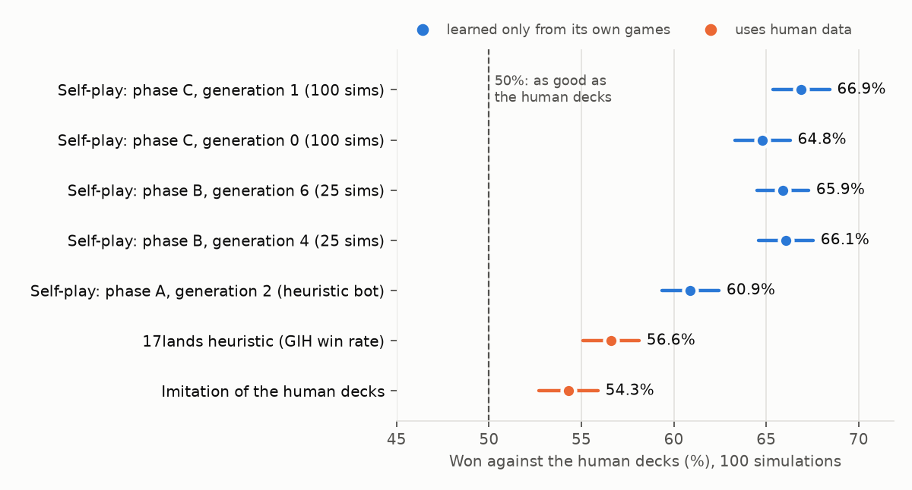
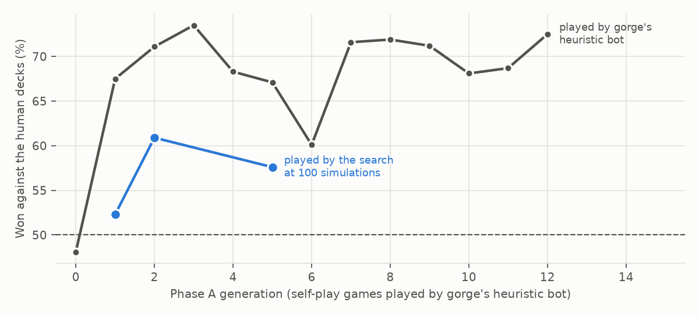
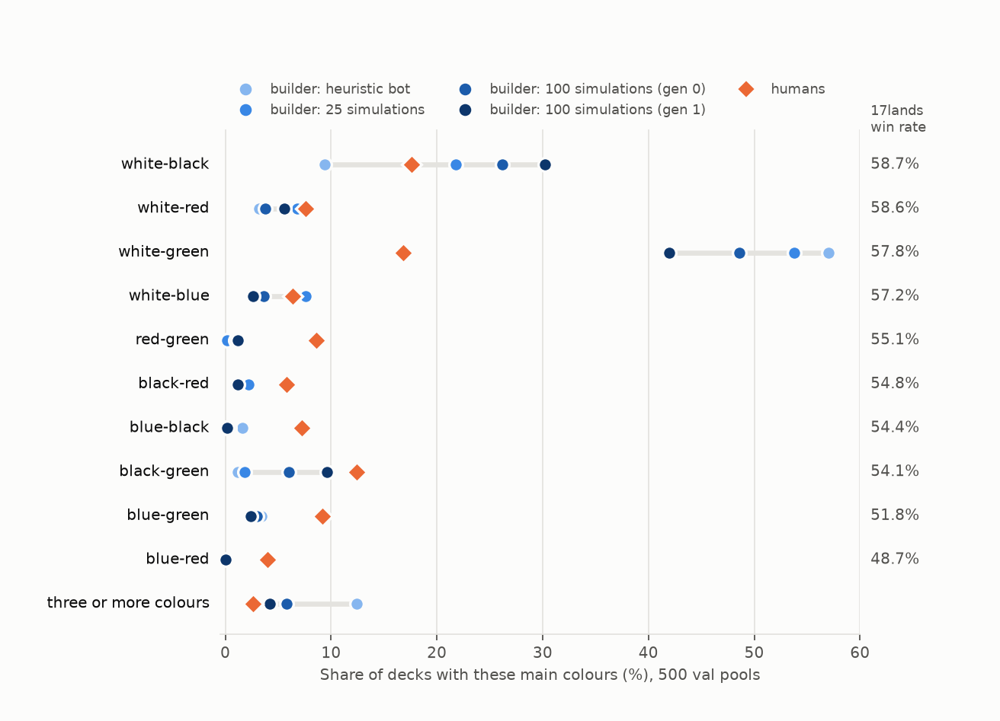

# Building sealed decks from self-play: FDN on gorge

*Status (Monday 12 October 2026, 3:00 PM PT): done for this round. A deck builder trained only on its own games builds
simple, white-based creature decks that its pilot can play well, and with them beats the human decks from the same
pools 64% of the time on fresh test pools; more search in its training games makes its decks steadily more human. The
code is on the [`sealed-deckbuilding`](https://github.com/danieljbrooks/draft-zero/tree/sealed-deckbuilding) branch
(`gorge/sealed/`).*

**The goal:** a model that builds a 40-card sealed deck from a pool of six FDN packs, trained **only from games it
plays**, never from human decklists, as a step toward bots that play sealed at a high level.

## Summary

- **What it learns:** trained only on its own games, the builder learns to build simple, white-based creature decks
  that the bot playing them (gorge's search with docs/031's network) can pilot well. This is how a newer human player
  builds: decks that play themselves. It skips cards whose value lies in choices, such as planeswalkers, tricks, card
  draw and fixing lands.
- **How well its decks do:** played by that bot on both sides, its decks beat the decks humans built from the same
  pools **63.8% of 2,000 games on the 1,000 test pools**, where the 17lands heuristic (best two colours by
  games-in-hand win rate) wins 55.2% and a builder trained to imitate the human decks wins 53.0%. On draft pools,
  which it never trained on, it wins 57.5% (heuristic 50.9%).
- **What drives it is the pilot:**
  - Cheap games played by a heuristic bot teach the basics in two generations, then mislead.
  - Games played by the search do better, and **the more search in the training games, the more human-like the
    decks**: white-green falls from 57% to 42% of decks (humans 17%), removal and fixing come in, and cards shared
    with the human deck rise from 18.6 to 20.5 of 40.
  - The pilot's own play gets more human-like up to about 100-300 simulations and then stops improving through
    1,000. So the next lever is the pilot, not the deck builder.
- **Along the way:**
  - The builder found a rules bug in gorge (Omniscience could cast itself for free), now fixed and reported upstream.
  - Searching against a learned value failed twice, on land counts and on castability. Each failure led to a fix that
    any new set would need too.

## 1. The task, in brief

In sealed, each player opens six packs (about 81 cards in FDN once basic lands are set aside) and builds a 40-card
deck: usually about 17 lands and 23 spells in two colours. The edge cases are what make it hard to hand-code:
non-land cards that work like lands, synergy decks with unusual shapes, three- to five-colour decks that need a mana
base to support them. Every new set changes which shapes work, so whatever the model knows about curves, land counts
and colours has to be learnable from games.

Terms:
- **The pilot** plays every game: gorge's search with docs/031's loop B network (generation 7) inside it, at N
  **simulations** per decision (look-ahead lines tried before each move), exploration constant 0.5 (docs/031 found
  it played best). At 0 simulations, gorge's built-in heuristic bot plays instead.
- **A paired game** plays the same deal twice with the seats swapped, which cancels much of the luck of the draw.
- **A generation** is one round of: build decks, play them against each other, retrain.

## 2. Data: pools, human decks and the splits

From 17lands' public FDN data (CC BY 4.0), `gorge/sealed/data.py`:

| Set | Pools | Use |
|---|---|---|
| Sealed (Bo1 + Bo3), train | 6,240 | **pool contents only**: the pools the self-play builder practises on |
| Sealed, val | 1,000 | choosing settings |
| Sealed, test | 1,000 | final numbers, used once |
| Premier Draft, val + test | 1,000 + 1,000 | the secondary test: does a sealed builder build draft decks well? |

- A 17lands game row lists the player's deck and the rest of their pool, so each pool comes with the deck(s) the
  human built from it. When a player rebuilt a pool, the build with the most games is the **reference deck**.
- Human reference decks on val: 94% have two main colours, 86% play 17 lands, about 23 spells.

## 3. How a builder is judged

| Measure | How |
|---|---|
| **Card agreement** | cards the builder's deck shares with the human's deck from the same pool, out of 40 (basics included); also whether the main colours match |
| **Win rate against human decks** | pools paired (i, j): the builder's deck from pool i plays the human's deck from pool j and the builder's deck from pool j plays the human's deck from pool i, each as a paired game: 4 games a pool pair. A builder identical to the humans scores exactly 50% |
| How human-like | colour distribution, deck shape (creatures, spells, lands), how often each card is played when it is in the pool |

**Read the win rate with care:** the same pilot plays both decks, so it measures how well a deck suits this pilot.
The human decks' strengths, such as tricks, card advantage and planeswalkers, need play this pilot doesn't have.

## 4. The method

```
                 ┌──────────────────────────── the self-play loop (one generation) ───────────────────────────┐
                 │                                                                                             │
  train pools ──►│  BUILD: for each pool, decks from the current         PLAY: decks from different pools      │
  (contents      │  value network (best, explore, perturbed, ...)   ──► play paired games in gorge            │
   only)         │        ▲                                              (the pilot at N simulations)          │
                 │        │                                                          │                         │
                 │  TRAIN: the deck value network on the last 4 generations' results ◄┘                         │
                 └─────────────────────────────────────────────────────────────────────────────────────────────┘

  BUILD, for one pool:  pick colours (score a quick deck for every colour combination)
                        → refine the best 4 by one-card swaps until no swap helps
                        → keep the candidate the network likes best
```

**A deck value network** (`gorge/sealed/model.py`) gives every deck a strength s. A game between decks a and b is a
comparison: P(a wins) = sigmoid(s(a) − s(b) + an on-the-play term), fit to game results (Bradley-Terry). s has three
parts:
1. **Card quality:** one learned number per card, weighted by how castable the deck's mana makes the card (§5.10). It
   plays the role of 17lands' games-in-hand win rate, learned from our own games; a draw term also uses which cards
   were actually drawn in each game.
2. **Structure:** a small network over deck totals built from learnable card *roles*: how much a card counts as a
   land, its effective mana value, whether it is a creature, which colours of mana it makes. Each role starts at the
   printed card and may move if the games say so, so the network learns this format's good curves, land counts and
   colour requirements, and can learn that a card with misleading printed facts (a 6-drop with landcycling) partly
   counts as a land.
3. **Context:** a set network over the deck's cards, for synergies the first two miss.

**The architecture, in detail.** The network scores a whole deck; it never outputs one. About 26,000 parameters per
network:

```
  deck: copies of each of FDN's 286 cards (a count vector)       card table (fixed): 76 printed facts per card
          │                                                                    │
          │            card vector (32) = MLP(76 → 32 → 32)(printed facts) + learned card embedding (32)
          │                                                                    │
          ├──► 1. quality:   Σ copies × castability(card, deck) × q(card)      q = linear(card vector) + per-card correction
          ├──► 2. structure: MLP(33 → 64 → 64 → 1) over deck totals built from learnable card roles
          └──► 3. context:   MLP(32 → 64 → 1) over the average (castable) card vector of the deck
                                              │
                                   s(deck) = 1 + 2 + 3, a single number
```

| Part | What goes in | Notes |
|---|---|---|
| Inputs | the deck as a count vector over 286 cards; a fixed table of 76 printed facts per card | facts: mana value, coloured pips, colour identity, colours a land makes, card types, power and toughness, rarity, 14 keywords, 29 mechanics tags. No pool, opponent or game state, and no human data |
| Card identity | a 32-number embedding, a quality correction and role corrections per card, indexed by the card's position in the count vector | all start at zero with an L2 penalty: a card with few games stays close to what its printed facts predict, and its games pull it toward its own value |
| Card roles | land-ness, effective mana value (a distribution over 0-7+), creature-ness, colours made | each starts at the printed card and drifts if the games say so |
| Structure totals (33) | curve of the non-land cards (8 bins), land count, creature count, sources and pips per colour, their ratios, under-supported colours, number of colours, deck size | the network learns the format's land count, curve and mana requirements from these |
| Castability | per spell, the product over the colours it needs of sigmoid(a × (sources − b − c × pips)) | three learned numbers, shared by all cards (§5.10) |
| Output | s(deck), one number | used two ways: P(deck A beats deck B) = sigmoid(s(A) − s(B) + β × [A played first]) in training, and as the score the builder maximises |

**Training uses game results only:**
- **Loss:** binary cross-entropy of that Bradley-Terry probability against who won.
- **Draw term:** the cards each player drew also enter the prediction, through those cards' q values (λ × the drawn cards' q, less what an average draw from the deck would hold).
- **Ensemble:** five networks, each fitted with AdamW on a bootstrap resample of the last four generations' games, early-stopped on held-out games. Their disagreement says where the model is unsure.
- **Warm start:** after phase A, each generation's networks start from the previous generation's.

**The builder** (`gorge/sealed/build.py`) follows the human process:
1. **Pick colours:** for each colour combination (5 mono, 10 pairs, 10 triples), a quick deck of its best cards by
   card quality, scored by the network.
2. **Build candidates:** the top four combinations are refined by swapping one card at a time (any deck card out, any
   pool card or basic land in) whenever the network scores the new deck higher, until no swap helps. Swaps can splash
   a card, change the land count or change a basic land's colour. This is the iterative "re-rank every card in the
   context of the current deck" idea, run to convergence. It stays inside the land counts the training games cover.
3. **Choose** the candidate the network likes best.

**The self-play loop** (`gorge/sealed/loop.py`): each generation builds five decks for each of 600-800 train pools:
- the best deck;
- a deck one ensemble member alone likes best (exploring where the members disagree);
- the best deck with 1-3 random swaps;
- the best deck with 1-3 lands more or fewer;
- 15% of the time, a random deck.

Decks from different pools play paired games, and the next ensemble trains on the last four generations. Generation 0
builds random deck-shaped decks with 1-5 colours and 12-21 lands, so the network also sees decks that don't work.

**The curriculum** (Dan): cheap games first, then games with more search.

| Phase | Training games played by | Games a generation | Machines |
|---|---|---|---|
| A | gorge's heuristic bot (0.04 CPU-seconds a game) | 40,000 | laptop |
| B | the search at 25 simulations (2.5 CPU-seconds), from A's generation 2 | 20,000 | r1 + a RunPod RTX 3080 Ti |
| C | the search at 100 simulations (11 CPU-seconds), from B's generation 6 | 10,000 | r1 + the same pod |

Every builder is judged with the search at 100 simulations, and some also at 300.

## 5. Results

### 5.1 The test pools: the final numbers

The builders chosen on val pools, scored once on the 1,000 untouched sealed test pools (2,000 games each, the search at
100 simulations playing both decks):

| Builder | Trained on | Cards shared with the human deck (of 40) | Main colours match | Won against the human decks |
|---|---|---|---|---|
| **Self-play (phase B, generation 4)** | its own games only | 19.2 | 25% | **63.8% ± 1.0** |
| **Self-play (phase C, generation 1)** | its own games only | 19.9 | 26% | **63.8% ± 1.0** |
| 17lands heuristic | human statistics | 20.5 | 29% | 55.2% ± 1.0 |
| Imitation of the human decks (same network and builder) | human decks | 23.6 | 36% | 53.0% ± 1.1 |

On the 1,000 Premier Draft test pools (no builder trained on draft pools):

| Builder | Cards shared (of 40) | Won against the human draft decks |
|---|---|---|
| **Self-play (phase B, generation 4)** | 31.6 | **57.5% ± 1.0** of 2,000 |
| Imitation of the human decks | 34.5 | 52.7% ± 1.1 of 1,999 |
| 17lands heuristic | 33.2 | 50.9% ± 1.1 of 2,000 |

- **The deck that agrees most with the humans is not the one that beats them:** imitation shares the most cards and
  wins the least.
- **On val pools** the same builders won 66.1% (phase B, generation 4) and 66.9% (phase C, generation 1); they were
  chosen as the best of several there, so a small drop on fresh pools is expected.
- **At 300 simulations** the val results hold: phase A's generation 2 59.4% (60.9% at 100), phase B's generation 2
  61.9% (61.6%) and generation 4 65.6% (66.1%), the 17lands heuristic 54.5% (56.6%), imitation 54.7% (54.3%).



### 5.2 What the builder learns: decks its pilot can play

Phase B's generation 4 against the humans, on 500 val pools:

| Main colours | Builder | Humans | Builder's decks won against the human decks |
|---|---|---|---|
| White-green | **54%** | 17% | 69.9% (269 pools) |
| White-black | 22% | 18% | 61.5% (109) |
| White-blue | 8% | 6% | 55.3% (38) |
| White-red | 7% | 8% | 67.6% (34) |
| Blue-green | 2% | 9% | 50.0% (12) |
| Black-red | 2% | 6% | 72.7% (11) |
| Black-green | 2% | 12% | 55.6% (9) |
| Red-green, blue-black, blue-red | under 1% each | 9%, 7%, 4% | |
| Three colours | 3% | 1% | |

| | Builder | Humans |
|---|---|---|
| Creatures | 17.2 | 15.4 |
| Non-creature spells | 5.4 | 7.8 |
| Average mana value of the spells | 3.39 | 3.06 |
| Lands (non-basic) | 17.5 (0.0) | 16.9 (1.3) |
| Splashes a third colour | 58 decks | 191 decks |

- **White, and white-green above all,** carry its decks, and its white-green decks win 70% against the humans'. In
  17lands' own sealed games the four white pairs also have the best win rates (white-black 58.7%, white-red 58.6%,
  white-green 57.8%, white-blue 57.2%), so the preference for white is the humans' too; the concentration on
  white-green is not.
- **It never plays** Evolving Wilds, Chandra, Flameshaper or Phyrexian Arena, and phase A's builder never played
  planeswalkers or equipment at all, preferring plain creatures (Savannah Lions, Juggernaut, Armasaur Guide: 90-100% of
  the pools that have them, against the humans' 10-30%).

**An example (val pool 0).** Both built white-black and share 30 of 40 cards; the builder won 2 of its 4 games.

- **Builder (17 lands, 8 Plains and 9 Swamp):** 16 creatures, including 2 Crypt Feaster, Campus Guide and Meteor Golem
  where the human has Giada, Font of Hope, Diregraf Ghoul and Dauntless Veteran; 7 spells, including a second Eaten
  Alive.
- **Human (16 lands, with 2 Evolving Wilds, Scoured Barrens and Soulstone Sanctuary):** 15 creatures; 10 spells,
  including Stab, Stroke of Midnight, Claws Out and Rise of the Dark Realms.

**Two clear mistakes by a human player's standard** (Dan): no Giada and no Scoured Barrens. Are they mistakes for this
pilot? A paired test answers it: in 100 of the builder's decks, the card replaces the weakest 2-3-drop creature (or a
basic land), and both versions play the same human decks on the same deals (800 games at 100 simulations).

| Card swapped in | Effect for this pilot |
|---|---|
| Giada, Font of Hope | -0.8 points (standard error 2.4) |
| Scoured Barrens | -1.8 (2.3) |
| Evolving Wilds | 0.0 (2.3) |

None of the three helps this pilot, so the builder's choices cost it nothing here; what makes them strong for people
is play this pilot doesn't do. A builder trained on games learns what wins *for the player who plays its decks*.

### 5.3 The pilot sets the ceiling: cheap games teach, then mislead (phase A)

Phase A's games were played by gorge's heuristic bot. The last column is the measure that matters: the search at 100
simulations playing the generation's decks against the human decks.

| Generation | Cards shared (of 40) | Main colours match | Lands | Won against the human decks, heuristic bot | Won against the human decks, search at 100 simulations |
|---|---|---|---|---|---|
| 0 (trained on random decks) | 17.2 | 13% | 14.3 | 48.1% | |
| 1 | 18.9 | 22% | 17.0 | 67.5% | 52.3% |
| **2** | 18.7 | 26% | 17.4 | 71.1% | **60.9%** |
| 3 | 19.1 | 26% | 18.1 | 73.5% | |
| 4 | 18.8 | 27% | 18.2 | 68.3% | |
| 5 | 19.0 | 30% | 18.1 | 67.1% | 57.6% |
| 6 | 18.5 | 29% | 19.4 | 60.1% | |
| 7 | 19.8 | 30% | 18.1 | 71.6% | |
| 8 (support region, land exploration, draw term from here) | 19.4 | 30% | 18.7 | 71.9% | |
| 9-12 | 18.4-19.1 | 26-27% | 18.5-19.2 | 68.1-72.5% | |



*Agreement on 200 val pools; win rates on 500 val pools (1,000 games; one standard error about 1.5 points). Generations
0-3 played under the Omniscience bug (§5.11).*

- **Cheap games teach the basics fast:** one generation fixes the land count (14 to 17), and by generation 2 the
  builder beats the human decks 60.9% when the search plays.
- **Then they mislead.** Later generations keep winning about 70% under the heuristic bot but fall to 57.6% under the
  search (generation 5). Three more bot-level generations from generation 2 (experiment E5's two runs, §5.9) took the
  builder to 49-50%: a coin flip against the humans.

### 5.4 Games played by the search (phases B and C)

| Phase, generation | Training games | Lands | Won against the human decks, 100 simulations |
|---|---|---|---|
| B, 0 | 25 simulations | 17.9 | 59.7% |
| B, 1 | 25 | 18.7 | 56.0% |
| B, 2 | 25 | 18.0 | 61.6% |
| B, 3 | 25 | 17.9 | 65.4% |
| **B, 4** | 25 | 17.5 | **66.1%** |
| B, 5 (castability from here) | 25 | 17.0 | 63.0% |
| B, 6 | 25 | 17.5 | 65.9% |
| C, 0 | **100 simulations** | 17.5 | 64.8% |
| **C, 1** | 100 | 17.4 | **66.9%** |

*1,000 games each on val pools; one standard error about 1.5 points. Phase B's generations took about 45 minutes,
phase C's 2-3 hours.*

Phase B climbed from 60% to 66% in four generations of 25-simulation games and then held; phase C's 100-simulation
games kept the win rate and changed how it builds (§5.5).

### 5.5 More search in the training games, more human-like decks

Each builder's decks on 500 val pools, against the human decks from the same pools:

| Training games played by | Cards shared (of 40) | Per-card play rate vs the humans' (rank correlation) | Colour distance to the humans' | Creatures | Non-creature spells | Non-basic lands |
|---|---|---|---|---|---|---|
| gorge's heuristic bot (phase A, generation 2) | 18.6 | 0.47 | 0.54 | 19.0 | 3.7 | 0.01 |
| search, 25 simulations (phase B, generation 4) | 18.9 | 0.55 | 0.44 | 17.2 | 5.4 | 0.00 |
| search, 100 simulations (phase C, generation 0) | 19.9 | 0.57 | 0.45 | 16.9 | 5.6 | 0.06 |
| search, 100 simulations (phase C, generation 1) | **20.5** | 0.57 | **0.41** | 16.8 | 5.8 | 0.14 |
| *the humans* | | | | *15.4* | *7.8* | *1.33* |

*Colour distance: total variation distance between the builder's and the humans' distributions over main-colour
combinations.*

**White-green falls at each step up in training search, and black takes its place.** One row per colour pair,
ordered by the pair's win rate in 17lands' own sealed games; dots are the builders' shares of decks, light (gorge's
heuristic bot) to dark (100 simulations), and diamonds the humans':



| Main colours | 17lands human win rate | Heuristic bot | 25 simulations | 100 simulations (C, gen 0) | 100 simulations (C, gen 1) | Humans |
|---|---|---|---|---|---|---|
| White-black | 58.7% | 9% | 22% | 26% | 30% | 18% |
| White-red | 58.6% | 3% | 7% | 4% | 6% | 8% |
| White-green | 57.8% | 57% | 54% | 49% | 42% | 17% |
| White-blue | 57.2% | 7% | 8% | 4% | 3% | 6% |
| Red-green | 55.1% | 1% | 0% | 1% | 1% | 9% |
| Black-red | 54.8% | 1% | 2% | 1% | 1% | 6% |
| Blue-black | 54.4% | 2% | 0% | 0% | 0% | 7% |
| Black-green | 54.1% | 1% | 2% | 6% | 10% | 12% |
| Blue-green | 51.8% | 3% | 2% | 3% | 2% | 9% |
| Blue-red | 48.7% | 0% | 0% | 0% | 0% | 4% |
| Three or more colours |  | 12% | 3% | 6% | 4% | 3% |

*Shares of each builder's decks on the 500 val pools by main colours; 17lands human win rate: all games of the human
sealed builds with those main colours (Bo1 and Bo3).*

**The colour choices are converging toward the humans' as the simulation budget grows:** the total variation
distance between the builder's and the humans' colour distributions falls from 0.54 (heuristic bot) to 0.44 (25
simulations) and 0.41 (100 simulations). The convergence isn't yet complete or even on every pair: white-black now
overshoots the humans (30% against 18%), while blue and red have barely moved.

- **Every measure moves toward the humans as the training games get more search:** fewer creatures, more removal and
  tricks, less white-green, the first non-basic lands, more cards in common. Cheap games teach the mechanics; games
  with more search teach the choices.
- **Black is what deeper search unlocks:** white-black and black-green reach or pass the humans' rates, plausibly
  because black's removal needs good targeting.
- **Blue and red stay almost absent** (4% across five pairs against the humans' 35%): their cards lean on tricks,
  card draw, counterspells and timing, the choices this pilot plays least well.

### 5.6 The realism ladder: does more search make play more human-like?

Dan's hypothesis: with little search, play is low quality and the builder favours cards that present no choices;
realistic games may need ~3,000 simulations. This measures the pilot alone, no deck building: the same 2,000 games
between real human decks (from sealed train pools, one fixed list of pairings and deals) at each depth.

| Played by | Card games-in-hand win rates vs 17lands (rank correlation; noise ceiling) | Colour-pair win rates vs 17lands (10 pairs) | Decks by stronger players minus weaker players | The deck with the better record on 17lands won |
|---|---|---|---|---|
| gorge's heuristic bot | 0.23 (0.71) | 0.04 | +0.6 points (SE 1.7) | 50.2% (SE 2.5) |
| search, 25 simulations | 0.34 (0.62) | 0.71 | +2.6 (1.7) | 51.2% (2.4) |
| search, 100 simulations | 0.37 (0.72) | 0.61 | +1.4 (1.7) | 53.8% (2.4) |
| search, 300 simulations | 0.37 (0.75) | 0.73 | **+3.6 (1.7)** | 53.8% (2.4) |

*Card columns: about 205 spells drawn at least 60 times; the noise ceiling is the most a perfect match could show
with 2,000 games (split-half reliability). Stronger players: 17lands' player win-rate bucket of 0.60 or more. Last
column: games between two decks that each played at least 5 games on 17lands with records at least 10 points apart
(418 of the 2,000).*

The deeper levels finished fewer games before the budget ran out. On the 722 games the 1,000-simulation level shares
with the others:

| Played by | Card win rates vs 17lands | The deck with the better 17lands record won (150 games) | Stronger minus weaker players' decks |
|---|---|---|---|
| gorge's heuristic bot | 0.16 | 49% | +0.8 points |
| 25 simulations | 0.31 | 52% | +2.9 |
| 100 simulations | 0.36 | 55% | +3.6 |
| 300 simulations | 0.27 | 54% | +3.9 |
| 1,000 simulations | 0.34 | 54% | +3.8 |

*At 722 games the card correlations are noisy (their noise ceilings range from 0.12 to 0.59); 150 games give the
middle column a standard error of about 4 points.*

- **Play gets more human-like with the first bit of search, then stops improving:** every measure rises from no search
  to 25 and 100 simulations and holds through 300 and 1,000, with card values well below the ~0.7 ceiling.
- **At 3,000 simulations** only 128 games finished: about 17 games an hour on a 15-core pod, so a 1,000-game level
  would cost about 60 pod-hours (~$8-10 on community pods). Whether ~3,000 simulations changes the picture remains
  open; through 1,000, more search alone does not make this pilot more human, which points at the network.

### 5.7 Card agreement is hard in sealed

Even the imitation builder, trained on 6,240 human sealed decks, shares only 23.8 of 40 cards with the human deck and
picks the same main colours about a third of the time. A sealed pool usually supports several reasonable colour
pairs, and once the colours differ most of the 40 cards do. Draft pools (about 41 cards, already mostly two colours)
are far easier:

| Builder | Sealed: cards shared (of 40) | Draft: cards shared (of 40) |
|---|---|---|
| Random deck-shaped build | 14.3 | 28.3 |
| 17lands heuristic | 20.3 | 33.3 |
| Imitation of human decks | 23.7 | 34.6 |

*1,000 val pools each.*

### 5.8 Does the pilot's search depth change which deck wins?

Before the loop: human reference decks against two kinds of decks from other val pools (4 games per pool pair).

| Pilot | Human decks vs random builds | Human decks vs the 17lands heuristic | Games each |
|---|---|---|---|
| gorge's heuristic bot | 65.4% | 46.5% | 2,000 |
| search, 25 simulations | 67.6% | 47.4% | 800 |
| search, 100 simulations | 64.2% | 45.8% | 400 |
| search, 300 simulations | 66.2% | 45.8% | 400 / 240 |

Coarse deck quality looks the same at every depth, which is why the curriculum started with the cheap heuristic bot.
The finer choices are where depth matters (§5.3-5.5).

### 5.9 Ideas that didn't help

| Experiment | Result |
|---|---|
| **E2, building cautiously:** the ensemble's mean minus one standard deviation, to avoid decks the networks disagree on | 54.4% against the plain mean's 57.6% on the same network: disagreement marks unexplored decks, and some are good |
| **E4, a playoff among candidates:** each val pool's top three candidates play 80 bot games against a fixed gauntlet, and a Bayesian pick combines the games with the network's score | 60.6% against the network's own choice's 60.9%: a paired difference of -0.3 points (standard error 1.3), over 101,840 games |
| **E5, a colour-diverse league:** a sixth deck per pool, the best one in a random colour pair, so the training field covers every pair | 48.7% against 50.2% without it, both after three more bot-level generations (from 60.9%) |
| **Forcing 17 lands:** phase B generation 1's decks (18-20 lands) with the land count set to 17 | -2.0 points on the same deals (standard error 1.6): the builder's land counts were fine; a correlation between lands and losing came from weaker pools |

The lesson from the last row: correlations inside an evaluation mislead, while a paired intervention on the same deals
is cheap and decisive.

### 5.10 Searching against a learned value: two failures and their fixes

A builder that searches over decks finds wherever the network is wrong. It happened twice:

- **Land counts.** Phase A's generation 6 built 43 decks with 23-24 lands and 7 with 7-8 lands on 200 val pools,
  although its own games had 21-land decks winning 31%. The network had learned "a basic land beats a weak spell"
  from decks with 17-19 lands and extrapolated.
  - *Fix 1:* the builder stays within the land counts that make up at least 2% of the training window's games. The
    range is read from the data, not hand-set.
  - *Fix 2:* an exploration deck with the land count shifted, so the edges get real results.
- **Castability.** In E5 a network built decks with red spells and no Mountains: 8.5 uncastable cards per deck on
  58 of 60 val pools. Exploration decks often carry one uncastable card and lose only 1-2 points for it, so the
  network learned such cards were nearly free.
  - *Fix:* each spell now counts in proportion to how castable the deck's mana makes it, a learned smooth function of
    the deck's sources of each colour the spell needs (after training: one pip with no sources counts 8%, with three
    sources 50%, with eight 97%). Retrained on the same games, 2 of 60 decks have such spells (0.2 cards each).
  - This is a rule of the game rather than a human preference, it carries to any set, and it makes a three- or
    five-colour deck's mana base matter.

**Card values from fewer games: the draw term.** A game result credits all 40 cards, but only the ~17 a player drew
can have mattered. As 17lands' games-in-hand win rate does, the network now also uses which cards were drawn, a
natural experiment free of the builder's own choices. It leaves the deck-level held-out loss unchanged (0.6506
against 0.6510) and makes card values steadier: separately trained networks rank the cards alike with a rank
correlation of 0.914, up from 0.854.

### 5.11 The builder found a rules bug in gorge

Phase A's networks ranked **Omniscience**, a 10-mana enchantment 17lands' players rank near the bottom, as the best
card in FDN. The games agreed: decks with it won 60% of their bot games, and 82% of the games where it was drawn.
gorge let Omniscience's "cast spells from your hand without paying their mana costs" work **while it was still in
hand**, so it cast itself for free and then made every later spell free.

- **The fix** (gorge patch 0009, `gorge/patches/`): a card's own static ability that names no zone works only on the
  battlefield, as the rules say. With it, the same 600 deck pairings give Omniscience decks 42.7% of 613 games and
  39.5% of the 256 where it was drawn: the dead card it should be.
- **Upstream:** the same bug let 44 other card/zone pairs in gorge's full card pool grant themselves a permission
  (Future Sight playing itself from the top of the library, for example). The fix, two regression tests and a census
  of the affected cards went to gorge as [adams-shaun/gorge#2](https://github.com/adams-shaun/gorge/issues/2) and
  [adams-shaun/gorge#3](https://github.com/adams-shaun/gorge/pull/3).
- **Here:** every machine ran the fixed engine from Monday 12 October, 12:00 AM PT; phase A's generation 2 won
  60.9% on the fixed engine against 61.3% on the buggy one, so the bug barely touched the results.
- **A use for the method:** a builder that optimises win rate exploits whatever the engine gets wrong, so a card
  whose learned value is far from its human rating is worth checking in the rules.

## 6. Compute

About 1.1 million games, from Sunday 10 PM to Monday 3 PM PT:

| Played by | Games | Used for |
|---|---|---|
| gorge's heuristic bot | ~921,000 | phase A, E5, the playoff, the depth test |
| search, 25 simulations | ~149,000 | phase B |
| search, 100 simulations | ~45,000 | every evaluation, phase C (20,000), the card audits |
| search, 300-3,000 simulations | ~8,500 | the evaluations at 300, the realism ladder |

Machines: the laptop, half of r1 (Dama's box), d1 (Dan's desktop) and community RunPod pods: $9.24 of the $10 budget.
A game at 100 simulations costs about 250 bot games, and one at 3,000 simulations about 30 times more again.

## 7. Prior work

No published builder reports either of our measures (agreement with human decks from the same pool, or win rate
against them), so there is nothing to compare these numbers with directly. The closest work:
- **Ryan Saxe's builder** ([RyanSaxe/mtg](https://github.com/RyanSaxe/mtg)) adds cards one at a time with a network
  trained on 17lands human decks, the approach of our imitation reference rather than of the self-play builder.
- **Heuristic builders** (Draftsim, the MTGA 17lands assistant, Heaton's "Lucille") take the best ~23 cards in two
  colours by a rating, as our 17lands baseline does.
- **Hearthstone deck building from simulated games:** Q-DeckRec (Chen et al. 2018) and DSA-ME (Zhang et al. 2022)
  learn a deck win-rate model and search over one-card swaps. Q-DeckRec found that search on a fixed learned model
  exploits its errors; DSA-ME retrains the model on the decks the search finds, as this loop does.
- **npiguet/price-predictor** scores sealed decks with a Bradley-Terry model of Forge games and builds by simulated
  annealing, the same structure as here with a fixed bot.
- **Legends of Code and Magic drafting** (Kowalski & Miernik 2020; Vieira et al. 2020) learns card values from games
  played by fixed agents, noting how few games each candidate gets.
