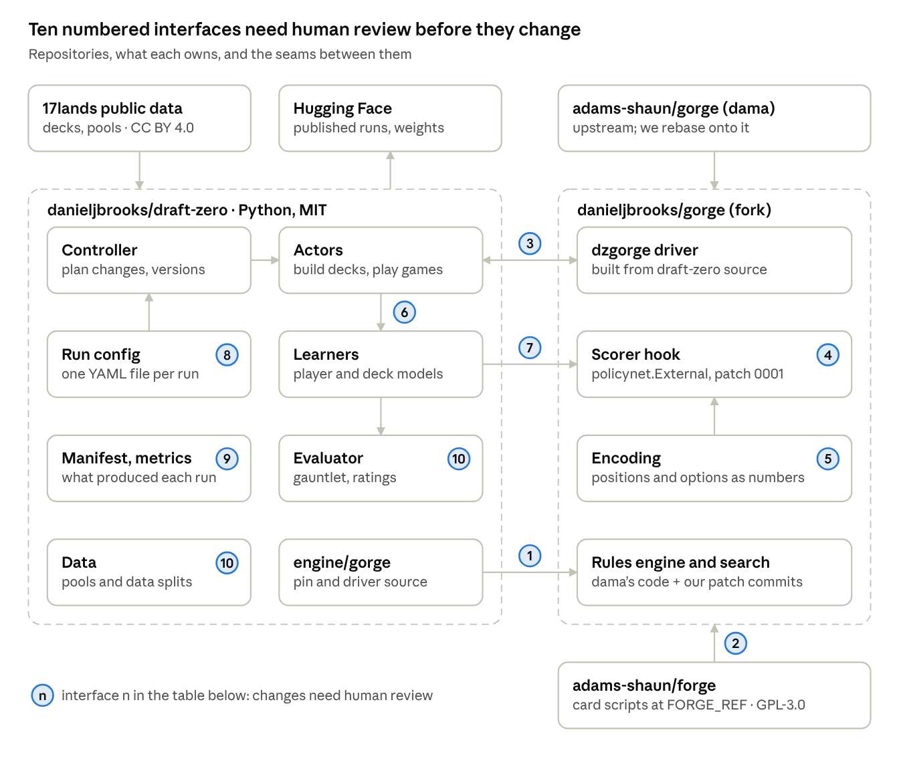
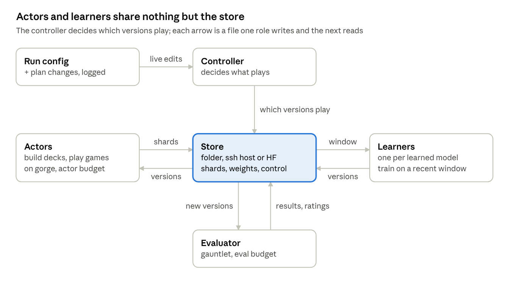

# DraftZero 0.2.0 refactor plan

*Started 2026-10-14 · Applies to v0.2.0 · Plan*

DraftZero 0.2.0 turns the repository into one reproducible training pipeline on gorge: a config-driven actor–learner loop for play, deckbuilding and (later) drafting, a manifest for every run, and a release for every major training run. Today's code is tagged v0.1.0 first, so nothing is lost; XMage support is removed.

## Update, 14 October: gorge main absorbed much of the plan

Later on 14 October we read gorge main at `813dcf3b4`. dama had already taken in most of what this plan expected to carry on our fork, so the fork, the opponent-deck model and the drafting environment all got smaller. The rest of this plan is edited to match; the changes are summarised here.

**Patches 0001–0007 and the driver are upstream.** dama vendored `cmd/dzgorge` into gorge main on 7 October (`912283267`), landed patches 0001–0007 in-tree and deleted `patches/` (`81ff36656`). The in-engine network moved to `internal/gonet`.

**The fork is now four commits on gorge main.** `danieljbrooks/gorge@draftzero` is gorge main `813dcf3b4` plus:

| Commit | What it carries | Why we still need it |
| --- | --- | --- |
| `aecc25799` | 0008 topk-max-options: a cap on the options the prior ranks under `topk=` | Without it, one 388-option decision held games for hours |
| `d7f44b921` | 0009 sims-by-kind: a simulation count per decision kind (`ksims=`) | docs/031's per-kind budget runs use it, and playout-cap randomisation would build on it |
| `948c522c1` | 0009 mayplay: Omniscience in hand no longer offers its own free cast | The bug is live on gorge main; self-play would learn to exploit it |
| `436712c1c` | Driver deltas on upstream's `cmd/dzgorge`: `-deckfile`, `-pairs-file`, `ksims=`, `-topk-max-options`, `-audit-*`, a flush after every game | Sealed games, recovery from hung games and the audit depend on them |

So `engine/gorge/build.sh` builds the fork's own `cmd/dzgorge` at the pin. It no longer copies a driver in or applies patches.

**`:closedlist` is the v0 opponent-deck model.** gorge main has closed-list search worlds. The searching seat knows its own decklist but not the opponent's. Each simulation draws one whole list from a belief corpus, uniformly among the lists whose colours cover the opponent's seen colours, removes the cards already seen and deals the rest. DraftZero passes the run's own decks as the corpus (`-belief-decks`, `-belief-pool`), so it stays tabula rasa. The plan's sampler-hook patch shrinks to a learned model behind `searchprobe.Belief`, later. The cost of hiding decklists is the same spec run with and without `:closedlist`.

**draftlab is the environment for deckbuilding and drafting.** gorge's `draftlab` package covers supply (FDN and BLB packs, sealed pools), 4- and 8-seat drafts, sealed, events (round robin and Swiss), a gauntlet, manifests, replay tapes and 17lands-shaped exports. Every call is a pure function of its arguments and seed. `draftlab/extern` adds `gorge-agent/1`, a JSON-lines protocol for external agents: a Python deck builder or drafter answers `build` or `pick` items. Search-based play stays in Go, with our MLP running in-engine through `gonet`, because an external agent sees only its own view and cannot simulate.

**Census-on is gorge's default.** gorge main turns the paid-mana census on by default (`eddaba289`), and the rules changed in other ways since the v0.1.0 pin (`c9a422b`). Networks and results from v0.1.0 are not comparable with 0.2.0's: re-baseline, and record the census setting in every manifest (`-no-paid-mana-census` turns it off).

**gorge main also adds `sbtactical`,** a stronger heuristic opponent. It replaces gorge's `bot` as the evaluation baseline. dama's closed-list network az-c4 scores 67.8% [64.0, 71.4] against it.

**What we still ask of dama:**

- Take 0008 and both 0009s upstream (0008 as a per-search option rather than a global).
- Make `searchprobe.Belief` an interface, so a learned opponent-deck model can sit behind it.
- Confirm that `cmd/dzgorge` is upstream-owned (gorge's package map marks it SUSP), and take our driver deltas. Then the fork can retire.

## Decisions at a glance

| Topic | Decision |
| --- | --- |
| Engine | gorge only in 0.2.0, pinned through our fork `danieljbrooks/gorge` (patches as commits). The fork is a stopgap: it retires once gorge can be a normal pinned dependency. mtg-kernel joins later behind the same engine interface. XMage support is removed; it stays available in v0.1.0. |
| Learning | Self-play only. Imitation learning is deprecated in v0.2.0. |
| Versions | v0.1.0 = today's code with the two gorge branches merged into main, no refactor. v0.2.0 = this refactor. Semantic versions after that. |
| Releases | Every major training run starts from a tagged release. Its results are published as a GitHub release plus a Hugging Face repo carrying the run's manifest. v0.1.0 ships the latest play network and deck builder. |
| Pipeline | One actor–learner loop for play, deckbuilding and, later, drafting. It is built from the existing `draftzero.selfplay` package (worker, trainer, controller, store), with gorge in place of XMage. |
| Storage | Hugging Face only; compute comes from elsewhere. A run works in a private Storage Bucket, where many actors can write; finished runs are published to versioned model and dataset repos. |
| Configs | One YAML file per run, checked against a schema. Plan changes mid-run go through the controller and are logged as events. |
| Reproducibility | Every run writes a manifest: code, engine, card corpus, config, seeds, machines. A synchronous mode replays a run exactly. |
| Experiment tracking | The run's files stay the record. Trackio mirrors them. Every experiment is registered with its question and success criterion before launch. |
| Hidden decklists | The search samples the opponent's unseen cards from a model of the opponent's deck. Version 0 is gorge's `:closedlist` with a belief corpus of the run's own decks; a small learned model, retrained periodically from those decks, comes later. Both stay tabula rasa. |
| Interfaces | Ten interfaces are rigid: changing one needs Dan's review, enforced by CODEOWNERS and a version bump. |
| Branches | 11 today. 6 are already contained in other branches and get deleted, 2 merge into v0.1.0, 2 become archive tags. After the refactor only `main` remains. |
| Docs | Each doc gets its start date and the version it applies to. A docs index lists them all. This plan becomes docs/033. |
| Tests | pytest and Go checks run in CI on every push. Contract tests pin the interfaces, and a smoke run checks the pipeline end to end. |

## Architecture



*The diagram predates the update above: the `dzgorge` driver is now upstream's `cmd/dzgorge` on the fork, and `engine/gorge/` holds only the pin and the build script.*

Two repositories do the work: DraftZero (Python) and our fork of gorge (Go). The actors drive gorge through the `dzgorge` driver (3). The learners' weights plug into gorge's search through the scorer hook (4, 7), and `GORGE_REF` pins the whole fork (1). Numbers match the interface table below.

## Interfaces that need human review

Ten interfaces are rigid: every result, checkpoint or comparison between runs depends on them. Everything else can change freely, by Dan or an agent, as long as the tests pass.

| # | Interface | Where it lives | Between | Why it is rigid |
| --- | --- | --- | --- | --- |
| 1 | Engine pin | `engine/gorge/GORGE_REF` → a commit on our fork's `draftzero` branch | DraftZero ↔ gorge | It sets the game rules and the search. Patch 0009 changed results without changing the pin |
| 2 | Card corpus pin | gorge's `FORGE_REF`, recorded in `.cards/cards.lock` | gorge ↔ Forge fork | It decides what every card does |
| 3 | Driver CLI and policy strings | `dzgorge play` flags (upstream's `cmd/dzgorge` plus our deltas), specs such as `az:sims=100:topk=6:gonet=…` | Python ↔ Go driver | Every config and script speaks it |
| 4 | Scorer hook | `policynet.External` (patch 0001, upstream since 7 October); later a learned opponent-deck model behind `searchprobe.Belief` | gorge's search ↔ our networks | The only code seam between the engine and our models |
| 5 | Position encoding | gorge's entity features (`internal/policynet/entity.go`, `features.go`, `option.go`) | gorge ↔ networks | A change invalidates every trained network |
| 6 | Training data and socket format | `dzg/SPEC.md`: shards `dzg-pack-1`, wire `GZB1`/`GZR1` | Go ↔ Python | Shards on disk and on Hugging Face must stay readable |
| 7 | Checkpoint formats | `.pt` (architecture, config, weights), `.dzgw` (the Go MLP) | trainer ↔ engine, published models ↔ users | Published models must keep loading |
| 8 | Run config schema | `src/draftzero/config.py` | people ↔ pipeline | Old configs must keep running, or fail loudly |
| 9 | Run manifest and metrics schema | `src/draftzero/manifest.py`, `metrics.py` | runs ↔ reports and papers | Reports and plots read every run the same way |
| 10 | Evaluation protocol and data splits | the gauntlet's opponents, simulations, paired games, seeds; train/val/test pools | runs ↔ runs | Changing either breaks comparisons with earlier runs; the test split is used once |

**The rule for changing one:**

1. Open a pull request that Dan reviews. `CODEOWNERS` lists these paths, so GitHub asks for his review.
2. Bump that interface's version (for example `dzg-pack-1` → `dzg-pack-2`) and keep a reader for the old one when published data uses it.
3. Update its contract test and add a line to `CHANGELOG.md`.

`AGENTS.md` lists the same ten, so a Claude session stops and asks before touching one, as gorge's own agent rules do.

**Free to change, with green tests:** new network architectures (added beside the old ones, never edited once published), trainer internals, actor, learner and controller internals, plots, experiment scripts, and docs other than published results.

## Engines

gorge is the only engine in 0.2.0. XMage is removed, because keeping it means a Java bridge, a pinned MageZero, JVM workers and XMage-format decks beside everything gorge needs. All of that stays usable at v0.1.0.

| Engine | 0.2.0 status | How it is wired |
| --- | --- | --- |
| gorge | first-class | Our fork `danieljbrooks/gorge`, branch `draftzero` = gorge main plus our four commits (see the update above). `engine/gorge/build.sh` clones the fork at the pin, downloads the cards, builds the fork's `dzgorge` and writes a build record. `draftzero.engine.gorge` (Python) builds policy strings and runs matches; it replaces `gorge/sealed/games.py` and `gorge/recipe/lib.sh`. |
| mtg-kernel | later | Today a Rust harness on the `test-mtg-kernel` branch (`mtgkernel/`, docs/025). It is archived as a tag now. First-class support means implementing the same Python engine interface and producing the same training records. Its networks would need their own encoding, so they are not comparable with gorge's unless the encoding is shared. |
| XMage | removed | Kept in v0.1.0 and its docs. |

**The fork is a stopgap.** It lets us pin gorge and our patches without asking dama for anything. Patch 0001, the opt-in search patches and the driver itself are already upstream. The sustainable structure has two parts:

1. gorge takes 0008, both 0009s and our driver deltas into its own `cmd/dzgorge`.
2. DraftZero then pins a gorge main commit directly (`GORGE_REPO` points at `adams-shaun/gorge`), and the fork is retired. The driver stays in gorge's tree, because it imports gorge's `internal/` packages.

Interface 1 stays the same throughout: one pinned commit identifies the engine.

The Python engine interface is four calls: `build()` (pin to binary plus build record), `version()` (what the manifest records), `coverage(pool)` (which decks the engine fully supports) and `play(match)` (games and training records out).

**What removing XMage deletes:**

- `java/` (the `mzbridge` worker), `tools/vocab/` and `tools/gameplay/MadProbe.java`.
- The MageZero dependency in `pyproject.toml`.
- `src/draftzero/engine.py`, `loop.py`, `final_eval.py`, MageZero's dashboard (`report.py`, `metrics.py`), the XMage deck pools (`pools.py`, `decks/extract.py`) and `gameplay/` (17lands and Arena logs as XMage states, imitation, the GNN on XMage graphs).
- `tools/search_bench/`, `tools/imitation_scale/`, `tools/selfplay/` and the XMage-era configs, deploy scripts and tests (about 20 of the 28 test files).

**What survives, after a review:**

- `selfplay/`'s store, control file and controller (the base of the actor–learner).
- `workers/` (local, ssh, RunPod), `hfsync.py`, `watchdog.py`, `resources.py`, `alerts.py`, `secrets.py`.
- `stats.py` and `reference.py` (card statistics against 17lands).
- `tools/extract_decks.py`, rewritten so it no longer needs an XMage jar for collector numbers.

**Imitation learning is deprecated in v0.2.0.** It went with XMage: turning human 17lands games into training positions was XMage-specific. 0.2.0 learns from self-play only. The imitation code, reports and checkpoints stay in v0.1.0.

## Training pipeline

One actor–learner loop trains every learned component: the player, the deck builder, the opponent-deck model and, later, the drafter. It is built from `draftzero.selfplay` (docs/021), which already has the roles and a shared store, with gorge in place of XMage.



Actors write shards and read new versions; learners read a window of shards and write versions. Nothing else connects them, which is why actors can run on any machine.

| Role | How many | What it does | Built from |
| --- | --- | --- | --- |
| Actor | many, on any machine | Builds decks with the current builder, plays self-play games with the latest published networks, writes shards of results and recorded decisions | `selfplay/worker.py`, `dzgorge play` |
| Learner | one per learned component | Trains on a sliding window of recent shards; publishes a version (`.pt`, plus `.dzgw` for the in-engine MLP) with the list of shards it trained on | `dzg/train.py`, `gorge/sealed/train.py` |
| Evaluator | a few | Plays each new version against a fixed gauntlet in paired games at the evaluation budget; writes results and ratings | `selfplay/evals.py`, `gorge/analyze.py` |
| Controller | one | The only writer of `control.json`: which versions actors play, evaluation jobs, plan changes, a status page | `selfplay/controller.py` |
| Store | one per run | A local folder, an ssh host or a Hugging Face Storage Bucket (see the next section) | `selfplay/store.py` |

**Two modes.** Async is the default: actors never wait, and each shard records the version that produced it. Runs are fully audited but not bit-for-bit repeatable. Sync mode plays a fixed number of games per version and the learner waits, as docs/031's loop does today. Use sync for experiments a paper relies on, because it replays exactly from the manifest.

**Budgets are config fields** (phase 1's second experiment varies them):

- the actor's simulations per move, the share of decisions recorded and exploration;
- the learner's training steps per new position (the replay ratio) and window size;
- the evaluation's simulations and number of paired games.

**A run config** is one YAML file, checked against the schema (interface 8). Its proposed shape:

```yaml
run: e1-baseline-mlp
code: v0.2.0                 # the release the run starts from
engine: {name: gorge}        # pin read from engine/gorge/GORGE_REF
format: {set: FDN, mode: sealed, pools: train}
seed: 31
components:
  player:  {arch: mlp, width: 256, learn: true}
  builder: {kind: heuristic, learn: false}
  oppdeck: {kind: mlp, learn: true}
  picker:  null              # drafting comes later
actor:   {sims: 25, record_every: 4, explore: true}
learner: {window_positions: 2000000, steps_per_position: 0.5, lr: 0.001, publish_every: 2000}
eval:    {gauntlet: standard-v1, sims: 100, pairs: 600}
mode: async
store: hf://buckets/danbrooks/dz-e1-baseline-mlp
```

**Changing the plan mid-run.** Fields are either live or fixed:

- Live: budgets, learning rate, window, evaluation schedule, which components learn, pause and resume.
- Fixed: engine pin, encoding, architecture, splits, seed.

To change a live field, run `dz plan <run> set learner.lr=3e-4`. The controller checks the change, applies it at the next version, and appends an event to `events.jsonl`: time, version, old and new value, who changed it. The effective config at any version is the base config plus the events up to that version. To change a fixed field, start a new run from a checkpoint: `dz run fork <run> --at v12`.

**Each component on the loop:**

- **Player:** dzg's mlp, transformer and gnn. The MLP runs inside the engine; the others are served over the socket.
- **Deck builder:** docs/032's deck value network and builder (`gorge/sealed/`) become `draftzero.build`. Actors build decks from pools (best, explore, perturbed, random) and play them; the learner trains on recent results.
- **Opponent-deck model:** see the hidden-decklists section.
- **Drafter:** an interface only for now (a pack and the picks so far in, a pick out). The draft environment is gorge's `draftlab`, and the interface is `gorge-agent/1`'s `pick` item.
- **Joint training:** all learners share the actors, since one game yields player decisions, a deck result and opponent-deck examples at once.

## Distributed actors on Hugging Face storage

Many actors writing to Hugging Face, with one learner per model, is a supported pattern. The working store must be a **Storage Bucket**, not a dataset repo. Hugging Face describes buckets as mutable, unversioned, S3-like storage for checkpoints, logs and intermediate data, and a bucket write is not a git commit.

**Why not a dataset repo, as `selfplay/store.py` uses today:**

- Every upload to a git-backed repo is a commit, and the Hub caps commits per repository; its error messages give 128 an hour.
- Thirty actors uploading every five minutes would make 360 commits an hour.
- Hugging Face also warns that a repo slows down after a few thousand commits.

**Limits that still apply to a bucket:**

| Limit | Free account | PRO | What we do |
| --- | --- | --- | --- |
| Hub API calls per 5 minutes, per account (every machine using Dan's token shares it) | 1,000 | 2,500 | Each actor uploads one batch of files every few minutes. Thirty actors at one upload per five minutes use about 30 calls a window |
| Private storage | 100 GB | 1 TB | Prune shards older than the learner's window; keep only what gets published |
| Public storage | best effort | up to 10 TB | Publish curated runs, not every shard |

**Layout and roles:**

- Each actor writes under its own prefix (`shards/<actor>/<seq>`), so two writers never touch the same file.
- The controller is the only writer of `control.json`, and each learner the only writer of its `versions/<component>/`.
- Learners follow the bucket's change stream (Hugging Face's live follow) instead of polling a listing.
- Uploads use `batch_bucket_files` or `sync_bucket` from `huggingface_hub`.

**Secrets:**

- r1 holds no secrets, by its house rule. Machines without a token hand their shards over ssh to a relay, which is the only process holding the token. The relay runs on d1, the laptop or a pod.
- Pods Dan rents can hold a fine-grained token limited to the run's bucket.
- A learner on r1's GPU reads and writes through the same relay.

**Publishing:** `dz publish` uploads the chosen versions, manifest and metrics to a versioned model repo, and the games to a dataset repo. Hugging Face cannot yet copy from a bucket into a repo without re-uploading, so publishing re-uploads.

Sources: Hugging Face's [Storage Buckets](https://huggingface.co/docs/hub/en/storage-buckets), [rate limits](https://huggingface.co/docs/hub/en/rate-limits) and [storage limits](https://huggingface.co/docs/hub/en/storage-limits) pages, read 14 October 2026. The 128-commit figure comes from the Hub's own error message; Hugging Face does not document per-action limits, which change over time.

## Hidden decklists: the opponent-deck model

With decklists hidden, the search needs a model of the opponent's deck, because each simulation must invent the cards it cannot see. Until gorge's closed-list worlds, its search re-dealt hidden cards from the opponent's real 40-card list (docs/026). The XMage-era search sampled whole decks from the FDN pool, and gorge's `:closedlist` does the same from a belief corpus: that is version 0 (see the update at the top). The learned model generalises it: it predicts the rest of the deck card by card from what has been seen.

**The first learned model, deliberately small:**

- **Input:** the opponent's cards seen so far, as counts over the set's card list, plus how many cards have been seen and the turn.
- **Output:** a probability per card for the unseen part of the deck. A sampler draws a completion of the right size that respects copy limits.
- **Network:** a small MLP, small enough to run inside the engine like the in-engine player MLP.
- **Training data:** the run's own decks. Take a deck, hide a random subset the way a game reveals cards, and predict the rest. Thousands of decks give millions of examples. No human decklists are used, so it stays tabula rasa.
- **Schedule:** it should converge in minutes, so its learner retrains whenever the deck population moves: each new builder version, or every N new decks.

**How it plugs in:** behind `searchprobe.Belief`, which `:closedlist` already calls once per simulation's re-deal (`closedDeal`). gorge main has the rest: the closed worlds, the re-identification events, the leak fixes and the seeding. What remains is a small patch (an extension of interface 4) that lets a learned model sit behind `Belief`, ideally upstream.

**Determinism:**

- The sampler draws from the engine's seeded generator (game seed, decision, simulation index), never a global one.
- Inference runs in Go, float32 on CPU, with a parity test against PyTorch, as the player MLP has.
- Every shard records the opponent-model version.
- The same seed with the same model versions gives the same game.

**How it is judged:**

- Held-out log loss, recall of the true remaining cards, and calibration.
- Search strength with sampled worlds against true-deck worlds, which measures the cost of hiding decklists.
- The same comparison against version 0, `:closedlist`'s uniform draw of whole lists in the seen colours.

## Reproducible runs

Every run is one directory with a fixed layout, written to the store as it runs and published whole. One page, [`docs/runs.md`](runs.md), explains it and lists every published run, and the README links to it. The layout below is the plan's; `docs/runs.md` has the store layout as built.

```
runs/<run-id>/                 run id: <date>-<experiment>-<variant>, e.g. 2026-10-20-e1-mlp
  config.yml                   the config as launched
  manifest.json                release and commit, gorge fork commit and build record, card corpus lock,
                               Python, torch and Go versions, machines, seeds
  events.jsonl                 plan changes, restarts, machines joining and leaving
  shards/                      games and recorded decisions (dzg-pack), each tagged with the versions that played it
  versions/<component>/v0042/  weights (.pt, .dzgw), training curve, the shards it trained on
  eval/                        paired-game results per version
  metrics.jsonl                every metric, in the standard schema
  report/                      the standard plots and summary.md
```

**Where data lives:**

| What | Where | Visibility |
| --- | --- | --- |
| A run in progress | a private Hugging Face Storage Bucket, `danbrooks/dz-<run>` (a local folder for small runs) | private |
| A published run's config, manifest, events, weights, evaluations, metrics, model card | Hugging Face model repo `danbrooks/draftzero-<run>` | public when published |
| A published run's games and decisions | Hugging Face dataset repo `danbrooks/draftzero-<run>-games` | public, optional per run |
| The code that produced it | the GitHub release the manifest names | public |
| The latest pre-0.2.0 models: docs/031's newest play network and docs/032's last deck builder | published with v0.1.0 as `danbrooks/draftzero-v0.1.0`. docs/031's networks are not on Hugging Face yet: d1 holds docs/031's loop F′ (generations 5 and 6), while E7, its best, is on r1; the deck builder is already public as danbrooks/draftzero-fdn-sealed-builder | public |
| Older checkpoints | `danbrooks/draftzero-checkpoints`: 76.7 GB in 2,887 files, last changed 9 October. XMage-era runs (three dated run folders, `exp4/`, `gnn/`, `sp028/`, `pilot`, `xmage`) and docs/027's gorge networks (`gorge027/`). Indexed in `docs/runs.md` | private |
| Already public | `draftzero-fdn-exp1` (0.6 GB), `draftzero-fdn-gnn` (0.1 GB), dataset `draftzero-selfplay-games` | public |
| Forge card scripts and gorge's compiled cards | never published (GPL-3.0); readers download them at the pinned ref | — |
| Pools and splits derived from 17lands | `assets/`, with attribution | CC BY 4.0 |

**Private storage is the binding limit.** The free account's 100 GB of private storage already holds 76.7 GB, all in the checkpoint repo, which leaves about 23 GB for private run buckets. Two ways to make room, both Dan's call:

- Publish the folders the docs cite as public v0.1.0 archive repos, since public storage is free.
- Drop regenerable bulk such as `exp4/tables` and `exp4/tables_graph` (35 GB together).

Deleting files from a git-backed repo frees space only after its history is squashed, which cannot be undone.

**Loading and running a published model:**

```bash
dz models pull hf://danbrooks/draftzero-2026-10-20-e1-mlp@v0042   # weights and manifest into the local cache
dz play -a model:2026-10-20-e1-mlp/v0042 -b bot --sims 100 --pairs 100
dz eval model:2026-10-20-e1-mlp/v0042 --gauntlet standard-v1
```

From Python, `draftzero.models.load("hf://…@v0042")` returns the network. It refuses to load when the manifest's encoding version differs from the engine's.

**Reproducing a run:** `dz run reproduce hf://danbrooks/draftzero-<run>` does the full chain:

1. checks out the release;
2. builds gorge at the pin and downloads the cards at the lock, verifying both digests;
3. runs the config again.

In sync mode the games match exactly; in async mode, statistically.

**Publishing:** `dz publish <run>` uploads the run, writes the model card and drafts the GitHub release. It stops for Dan's confirmation before anything goes public.

## Metrics, plots and experiment tracking

Every run logs the same metrics to one file and draws the same plots, so any two runs compare side by side. Each line of `metrics.jsonl` has time, run, component, version, step, metric name, value, and, when it applies, the sample size and a 95% interval.

| Group | Metrics | Logged by |
| --- | --- | --- |
| Throughput | games and positions an hour, simulations a second, CPU, GPU and RAM per machine | actors |
| Learning | policy cross-entropy against the uniform baseline, target entropy, top-1 agreement with the search, value log loss, AUC, Brier score, on the holdout and validation sets | learners (`dzg/train.py` logs these today) |
| Strength | paired win rate with its interval against each gauntlet opponent; Bradley–Terry (Elo) ratings across all versions and runs | evaluator |
| Deckbuilding | card agreement with human decks, win rate against human decks, land and colour counts | evaluator (docs/032 §3) |
| Opponent model | log loss, recall of the true cards, calibration | its learner |
| Format knowledge | card games-in-hand win rate against 17lands, Spearman ρ | evaluator (`stats.py`) |

**The gauntlet** is a closed list of opponents, versioned as interface 10. `standard-v1` would hold gorge's heuristic bot, the full search without a network at 100 simulations, and fixed reference networks such as docs/031's best.

**Plots** come from one module, `draftzero.plots`, with the docs' look in light and dark:

- learning curves;
- strength by version, with intervals;
- the rating ladder across runs;
- throughput over time;
- a deckbuilding panel;
- card statistics against 17lands.

`dz report runs/<id>` draws them and writes `summary.md`, and the controller's status page shows them live.

**Rating history:** every evaluated game is kept, one line each, in a shared results table (`danbrooks/draftzero-ratings`). Ratings can then be recomputed whenever a new version joins. This answers dama's point about Elo runs: results alone are tiny, and full game logs stay optional.

**Experiment tracking.** The run's files stay the record (interface 9), and a tracker is a view onto them.

- The controller mirrors `metrics.jsonl`, the config and the events into the tracker. It runs on a machine that holds the token.
- Actors therefore need no tracker credentials.
- Swapping trackers means replacing one module.

| Tracker | Strengths | Costs |
| --- | --- | --- |
| [Trackio](https://huggingface.co/docs/trackio/en/index) (Hugging Face, MIT, free) | W&B-style API; local-first; dashboards on a free Hugging Face Space with data in a bucket; a public dashboard per run suits papers | young and deliberately small (under 3,000 lines), so fewer tools for comparing runs |
| MLflow (Apache-2.0) | mature: parameters, metrics, artifacts, run comparison and search, a model registry | needs a tracking server every logger can reach; public sharing takes hosting work |
| Weights & Biases | the most polished interface | closed and hosted; a key on every logging machine |

**Decision (Dan, 14 October): Trackio.** It keeps everything on Hugging Face. MLflow stays the fallback if Trackio's run comparison ever falls short; since the controller only mirrors files, switching means replacing one module.

**Rigor beyond the tool:** `docs/runs.md` keeps an experiment register.

- Before launch, each experiment gets an ID, its question, its success criterion and its config.
- Afterwards, the register adds its release, runs and result.

Writing the criterion first keeps reports and papers honest.

## Tests

The tests are good but uneven, and nothing runs them automatically:

- `tests/` has 28 files, mostly for XMage-era code.
- `gorge/dzg/tests/` has 8, which run on CPU in about 10 seconds.
- `gorge/sealed/` and `gorge/recipe/` have none.
- `main` has no CI.

0.2.0 sorts the tests into four tiers:

| Tier | What it covers | Needs | Runs |
| --- | --- | --- | --- |
| `tests/unit/` | one module at a time, on synthetic data (`packfmt.write_synthetic` already makes shards) | Python, CPU torch | every push; target under a minute |
| `tests/contract/` | one test per rigid interface: golden files for shards, the socket format, the manifest and config schemas, checkpoint loading, policy strings, the Go–PyTorch parity check | Python; Go for the parity check | every push |
| `tests/engine/` | the gorge driver: coverage, a few games, recording; determinism (same seed and versions give byte-identical games) | a built gorge | pull requests and nightly |
| `tests/smoke/` | a whole tiny run: two actors, a few games, one learner step, one evaluation, the report, a sync-mode replay | a built gorge | pull requests and nightly; target under 10 minutes |

**Conventions:**

- Every bug fix comes with a test.
- Every file in `configs/` must pass the schema test.
- Tests use small committed fixtures: the sample decks in gorge's format and synthetic shards.
- CI builds gorge at the pin and may cache the downloaded cards, but never uploads them as an artifact (GPL boundary).

**What moves:** dzg's tests go to `tests/unit/nets/`. The engine-free tests in `tests/` (alerts, hfsync, secrets, watchdog, paths) stay. The XMage tests leave with XMage.

## Repository cleanup

After the refactor the repository holds only what 0.2.0 runs. Everything older stays reachable through v0.1.0 and two archive tags.

**Target layout:**

```
draft-zero/
  README.md  CHANGELOG.md  ROADMAP.md  AGENTS.md  CODEOWNERS  LICENSE  pyproject.toml
  engine/gorge/        GORGE_REPO, GORGE_REF (fork commit), build.sh; the Go driver lives on the fork
  src/draftzero/
    cli.py             the dz command
    config.py          run config schema            (interface 8)
    manifest.py        run provenance                (interface 9)
    engine/            gorge.py; mtgkernel.py later
    loop/              actor, learner, evaluator, controller, store
    nets/              player networks: models, train, serve, export, SPEC.md   (interfaces 6, 7)
    build/             deck builder
    oppdeck/           opponent-deck model
    draft/             picker interface and draft environment (later)
    data/              17lands pools, decks, splits
    eval/              gauntlet, paired games, ratings, card statistics
    metrics.py  plots/ standard metrics and figures
    workers/  hub.py   machines and Hugging Face
  configs/             base/, runs/, smoke.yml
  assets/              splits, sample decks, small reference tables
  docs/                numbered and dated docs; README.md (index), runs.md, architecture.md
  tests/               unit/, contract/, engine/, smoke/
```

**What moves where:**

| From | To |
| --- | --- |
| `gorge/build.sh`, `GORGE_REF` | `engine/gorge/` |
| `gorge/cmd/dzgorge/` | deleted: the driver is upstream's `cmd/dzgorge`, with our deltas as a commit on the fork |
| `gorge/patches/` | 0001–0007 are upstream; 0008 and both 0009s are commits on the fork's `draftzero` branch; the files are deleted |
| `gorge/dzg/` | `src/draftzero/nets/` |
| `gorge/sealed/` | `src/draftzero/build/`, its pool code to `data/` |
| `src/draftzero/selfplay/` | `src/draftzero/loop/` |
| `gorge/decks.py`, `tools/extract_decks.py` | `src/draftzero/data/` |
| `gorge/analyze.py`, `stats.py`, `reference.py` | `src/draftzero/eval/` |
| `gorge/figures.py`, `dzg_figures.py`, `recipe/figs.py` | `src/draftzero/plots/` |
| `gorge/recipe/*.sh`, `dzg_*.sh`, `azloop.sh`, `experiments.sh` | replaced by configs and `dz run`; kept only in v0.1.0 |
| `ROADMAP.md` (49 KB, XMage-era) | rewritten short: phases 1–4 and the experiment roadmap |
| `tools/compute_bench/pods.py` | `workers/runpod.py`; the rest of the benchmark stays in v0.1.0 |

**Branches (checked on GitHub today):**

| Branch | Against `main` | Action |
| --- | --- | --- |
| `exp2-pilot`, `exp2-run2`, `final-eval`, `gameplay-data`, `v02-migration` | fully merged (0 commits ahead) | delete |
| `claude/gorge-fdn-selfplay` | 31 ahead, all contained in `gorge-train` and `sealed-deckbuilding` | delete |
| `gorge-train` | 73 ahead; docs/031's code; runs in flight | merge into `main` for v0.1.0 once its runs end, then delete |
| `sealed-deckbuilding` | 116 ahead; docs/032's code; 63 ahead of and 20 behind `gorge-train` | merge into `main` for v0.1.0, then delete |
| `selfplay-transition` | 20 ahead; docs/028–029's XMage code (the docs are already on `main`) | tag `archive/selfplay-transition`, then delete |
| `test-mtg-kernel` | 1 ahead; the mtg-kernel harness and docs/025's code | tag `archive/test-mtg-kernel`, then delete; port it when mtg-kernel goes first-class |

An `archive/` tag is the pre-0.2.0 marker. It keeps every commit reachable after the branch is gone, and `git checkout archive/test-mtg-kernel` brings the branch back. `CHANGELOG.md` lists both tags under v0.1.0.

## Versions, releases and dated docs

The code takes semantic versions, starting at v0.1.0 for today's code (`pyproject.toml` already says 0.1.0). Every major training run starts from a release.

**Version numbers while in 0.x:**

- A minor bump (0.2.0, 0.3.0) marks a change to a rigid interface or to how the pipeline runs.
- A patch bump (0.2.1) covers fixes and additions that keep every interface.
- The installed version is `draftzero.__version__`, and every manifest records it.

**The first two releases:**

- **v0.1.0:** `main` with `gorge-train` and `sealed-deckbuilding` merged in, no refactor. Its release notes list what it holds: the XMage pipeline (experiments 1–4), gorge self-play (docs/026–027), the recipe search (031) and sealed deckbuilding (032). They also list the two archive tags and the checkpoint repo.
- **v0.2.0:** tagged when the work plan's last step passes.

**One release per major training run:**

1. Before launch, cut a release, with a patch bump if the code changed.
2. The config names it (`code: v0.2.1`). The launcher refuses to start a publishable run from a dirty tree or from a commit other than that tag. `--dev` allows untagged runs that won't be published.
3. After the run, the release notes get a Runs section linking the Hugging Face repo and the report doc.

The existing tag `exp1-fdn-generalist` stays; later runs point at releases instead of new tag types.

**`CHANGELOG.md`** follows the Keep a Changelog style (Added, Changed, Removed), plus an Interfaces subsection whenever a rigid interface changes version.

**Dated docs:**

- Each doc gets one line under its title, for example `*Started 2026-10-11 · Applies to v0.1.0 · Report*`.
- The start date is the date of the commit that first added the file (`git log --diff-filter=A --format=%as -- <doc>`). One script stamps every current doc; a template stamps new ones.
- Every current doc applies to v0.1.0.
- Numbers stay as they are, so links keep working. Number 030 stays reserved for the uncommitted plan from another session.
- `docs/README.md` indexes them all: number, title, start date, version, kind (plan, report, run log, reference) and, where relevant, what superseded it.

## README

The README answers four questions quickly: what this is, whether it works yet, how to run it, and where everything else is. Experiment detail moves to the docs.

1. **DraftZero** and one line: agents that play Magic limited tournaments end to end, drafting, building and playing, learned from self-play. Badges for version, licence and CI.
2. **Status:** the current best result per component in a short table, each row linked to its doc and its published model.
3. **How it works:** a small pipeline picture (actors, learners, evaluator, store) and one paragraph. It links to `docs/architecture.md`.
4. **Quick start:** install, build gorge, a smoke run, then play a published model.
5. **Running experiments:** configs, `dz run`, changing the plan mid-run, resuming, and the status page.
6. **Using trained models:** `dz models pull`, `dz play`, `dz eval`, and the Python `load`. It links to `docs/runs.md` for every published run.
7. **Reproducing a published run:** `dz run reproduce`.
8. **Repository layout:** the table from the cleanup section.
9. **Data and licences:**
   - 17lands (CC BY 4.0, with attribution);
   - Forge card scripts (GPL-3.0, downloaded, never shipped);
   - gorge (Apache-2.0);
   - this code (MIT).
10. **Related projects:** gorge, Forge and dama's fork of it, mtg-kernel, MageZero, XMage and 17lands, each with a line on how it relates.
11. **Docs:** a link to the index.
12. **Citing:** a BibTeX entry.
13. **Credits and licence.**

## Work plan

The refactor is twelve steps, each with a check that says it is done. Steps 0–4 are strictly in order. After step 4, steps 5–7 can run in parallel. Contract tests (step 8) get written alongside each interface as it lands.

- [x] **0. Freeze and tag v0.1.0. Done 14 October, release published; its models are still to add.** docs/031's and docs/032's runs have ended, so this can start now. Merge `gorge-train` and `sealed-deckbuilding` into `main`. Then tag v0.1.0 and write its release, publishing the latest play network and deck builder with it. Inventory the private checkpoint repo, create the two archive tags, then delete every branch except main. *Done when GitHub shows only `main`, release v0.1.0 and the two archive tags.*
- [x] **1. Pin gorge through our fork. Done 14 October: the fork is rebased on gorge main (`813dcf3b4` plus four commits, tip `436712c1c`); the push to GitHub waits for a token with the `workflow` permission.** Create the `draftzero` branch on gorge main with 0008, both 0009s and our driver deltas as commits (0001–0007 are upstream). `build.sh` builds from the fork and writes the build record. *Done when the fork's `dzgorge` builds and plays a fixed-seed smoke match. Games can no longer be byte-identical to v0.1.0's, because gorge main changed the rules since the old pin (census on).*
- [ ] **2. New layout, XMage out.** Do the moves in the cleanup table, delete the XMage code and the MageZero dependency, and add `AGENTS.md` and `CODEOWNERS`. *Done when a fresh `pip install -e .` pulls no MageZero, unit tests pass, and no XMage import remains.*
- [ ] **3. Config, manifest, run directory, metrics schema.** *Done when the smoke config launches and writes its manifest and metrics, and the schema test loads every file in `configs/`.*
- [ ] **4. The actor–learner on gorge.** Turn `selfplay/` into `loop/`, with a gorge actor, the dzg learner and a controller that applies plan changes. Support sync and async modes, and local, ssh and Hugging Face Storage Bucket stores, with a relay for machines that hold no token. *Done when the smoke run passes in both modes, a mid-run change lands at the next version and is logged, and a sync replay is byte-identical.*
- [ ] **5. Evaluator, ratings, plots, report, tracker.** *Done when `dz report` draws the standard plots for the smoke run, with ratings across its versions, and the tracker shows the same run.*
- [ ] **6. The deck builder on the loop.** *Done when it reproduces docs/032's generation-1 result within its interval.*
- [ ] **7. Opponent-deck model.** Version 0 is `:closedlist` with a belief corpus of the run's own decks; then a learned model behind `searchprobe.Belief`. *Done when its held-out metrics are logged and the search with sampled worlds has been measured against true-deck worlds.*
- [ ] **8. Tests and CI.** Build the four tiers, the contract tests and GitHub Actions. *Done when CI is green on `main`, and a deliberate change to a contract file fails CI without a version bump.*
- [ ] **9. Docs.** This plan as docs/033, the date-stamp script, the docs index with its experiment register, `docs/architecture.md` (this plan's diagrams), `docs/runs.md`, the new README and `CHANGELOG.md`. *Done when every doc carries its line and the README has every section in the outline.*
- [ ] **10. Reproduce a baseline, tag v0.2.0.** Rerun docs/031's best recipe on the new pipeline. *Done when its strength matches the v0.1.0 result within the interval. Then tag v0.2.0.*
- [ ] **11. Walkthrough with Dan.** Cover the architecture, a live smoke run, a mid-run plan change and a publish. *Done when Dan can launch, change and publish a run without help.*

## Experiment roadmap

Phase 1's experiments run in this order on the 0.2.0 pipeline. Each needs only components this plan builds, except drafting, which also needs a draft environment.

1. **Baseline self-play.**
   - The player (MLP, then GNN) trains from scratch on the actor–learner, with decklists hidden and the opponent-deck model on. The builder is fixed and heuristic.
   - The question: does the async loop match docs/031's generation loop at equal compute?
   - Its result becomes the baseline every later run compares against.
2. **Actor and learner budgets.**
   - Vary the actor's simulations (25, 50, 100), the share of decisions recorded, the replay ratio and the window.
   - The question: which mix gives the most strength per CPU-hour? This seeds phase 2's recipe search.
3. **Learn deckbuilding.**
   - Run docs/032's builder on the loop, first with experiment 1's player frozen, then with the two alternating.
   - The question: does the 61% against human decks hold with hidden decklists, and does it rise with a stronger player?
4. **Learn drafting.**
   - The picker learns from the builder's valuation of the pools it drafts.
   - 0.2.0 ships only the interface. The draft environment is gorge's `draftlab`, with the picker as a `gorge-agent/1` `pick` agent.
5. **Joint training.**
   - Player, builder and drafter learn together from the same games.
   - Compare against the sequential order: experiment 1, then 3, then 4. This is phase 2's sequential-to-joint recipe.
6. **More experiments.**
   - Candidates: Gumbel root selection, the transformer or GNN inside the engine, and an mtg-kernel cross-check.

**Later phases, as background.**

- **Phase 2** runs on this infrastructure: the recipe search (actor and learner budgets), distributed actors with Hugging Face as the store, a publishable experiment plan, an architecture choice, a draft prototype, and hardening.
- **Phase 3** trains the end-to-end model on the full set and may need compute funding.
- **Phase 4** is the writeup, human games, gorge as a product, and community communication.

The configs, distributed store, ratings and publishable runs in this plan are what phase 2 needs from day one.

## Open questions

**For dama:**

- [x] What do gorge's hidden-decklist settings look like, and does the refactor offer a hook for sampling the opponent's deck? Answered by gorge main: `:closedlist` with a belief corpus (`-belief-decks`, `-belief-pool`). There is no hook for a learned model yet, so step 7's learned model needs `searchprobe.Belief` to become an interface.
- [x] Should our run config share field names with dama's planned YAML (player, deck builder, bot picker)? gorge main has no YAML and plans none: it composes agents through `draftlab`'s Go API and spec strings, so our config maps onto those.
- [x] Will gorge's draft buildout provide the draft environment (packs, eight seats), or do we build our own? Yes: `draftlab`, with `gorge-agent/1` for external drafters and builders.
- [ ] Later, once the refactor settles: would dama expose the packages `dzgorge` uses and merge our patches, so the fork can retire? He vendored `cmd/dzgorge` and 0001–0007. Still open: 0008 and both 0009s, the driver deltas, and whether `cmd/dzgorge` is upstream-owned.

**For Dan:**

- [x] Log in to Hugging Face inside the `d1` container (done 14 October, read token).
- [ ] The private checkpoint repo holds 76.7 of the free 100 GB. Publish the cited folders as public archive repos, drop `exp4`'s 35 GB of tables, or both?
- [ ] Answered: docs/032's builder is public as danbrooks/draftzero-fdn-sealed-builder (code at tag sealed-builder-v1). docs/031's best network (E7, loop F generation 1) is on r1, which is down.

**Answered by Dan, 14 October:**

- docs/031's and docs/032's runs have finished, so step 0 can start.
- Hugging Face is storage only; compute comes from elsewhere. Many actors writing with a single learner is covered under distributed actors.
- The account is free: 1,000 API calls per 5 minutes, 100 GB private storage, and free best-effort public storage. Published runs go public; working buckets stay private and pruned to the learner's window.
- Publishing model weights is fine.
- The latest checkpoints get indexed and published, the deck builder included.
- Imitation learning is deprecated in v0.2.0.
- This plan goes into the repository as docs/033.
