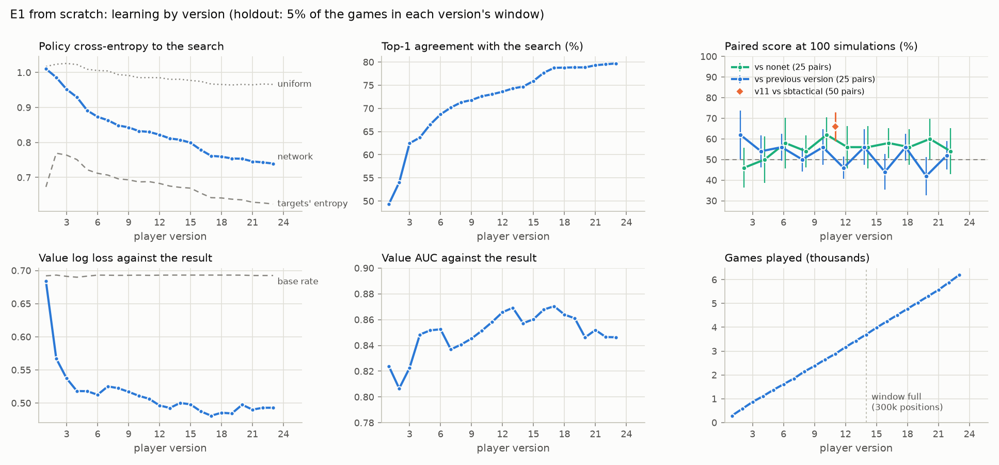

# The first experiments on the 0.2.0 pipeline

*Started 2026-10-14 · Applies to v0.2.0 · Report*

*Status (Thursday 15 October 2026, 2 PM PT): E1, E2b, E2c, E6 and the offline studies are done. E3 (the deck builder)
runs on (§10). The summary list below was written at 4 PM, mid-run; the
sections hold the final numbers.*

**The 0.2.0 actor-learner pipeline ran its first real experiments on 14 October, and it works.**
- **E1** trained a width-128 MLP player from scratch, with its actors on rented pods and its learner on d1. It ran
  8.9 hours, to version 36 and 9,936 games. Version 36 beats gorge's `sbtactical` bot **67.5%** of the time (62.4-72.6,
  100 pairs), 8.0 points more than B17, docs/031's best network, on the same deals (+1.5 to +14.5). Against the
  network-free search (`nonet`) it scores 63.4% (61.2-65.6, 500 pairs), just short of the register's 64%, and was
  still rising when it stopped (§4).
- **Playout-cap randomisation did not help.** Neither PCR arm beat the control in E2b, and E2c, with three times the
  data, found PCR 200/40 dead level with it (50.2%, 200 pairs; §7).
- **More training per position helped** on held-out games: E1's own replay beat 2, 4 and 8 steps per new position
  (§5.4).
- **Both E1 and E2c stopped gaining against fixed opponents** while their policy loss kept falling. Offline, neither
  replay nor network size explains it (§5.4, §5.6). E6 tested the value target live: half game results made no
  difference (50.4% head to head over 500 pairs), and neither arm improved on E1's version 36 (§11).
- **The two new engine features work as designed:** the decided-game search saves 12.5% of simulations per searched
  decision, and forced playouts prune 4.5% of visits from the policy targets.

Spend: about $8.60 on RunPod across E1, E2b, the network-volume test (docs/035) and E6.

Numbers are measured unless marked *estimate*. Scores come from **paired games**: each deal is played twice with the
seats swapped. Their 95% intervals are computed over pairs (the score ± 1.96 standard errors of the per-pair mean).
In the working log, "61.0% ± 3.6" meant one standard error.

## Summary

- **The pipeline worked end to end.**
  - A distributed smoke run (S1) passed: an actor on a RunPod pod, with the controller, learner and evaluator on d1,
    joined by `dz relay`.
  - E1 ran 5.6 hours through version 23: 6,192 games, 23 versions, no role errors.
  - Nobody watched it for a 2-hour stretch, which included a 3-minute SSH outage that the relay recovered from on
    its own.
- **E0:** B17 on the 0.2.0 engine (the paid-mana census on, hidden decklists) scores 61.0% against `sbtactical`. It
  is the reference that E1 and E2b are measured against.
- **E1, from scratch:**
  - **The policy learns steadily.** Cross-entropy to the search's visits fell from 1.010 to 0.740, and agreement with
    the search's top move rose from 49% to 80%.
  - **The value learned fast and has been flat since about version 13:** log loss 0.48-0.50 against the game
    result (0.693 for a constant guess), AUC 0.85-0.87.
  - **Strength against the search without a network** rose from 52.0% (versions 2-8, 100 pairs) to 57.4%
    (versions 10-22, 175 pairs; 51.1-63.7).
  - **The cheap per-version matches are too small to show a version's step.** Each is 25 pairs, and they average
    50.3% against the previous version since version 10.
- **Offline studies:**
  - **About a fifth of positions come from a game that is already decided:** 18.4% of recorded decisions follow
    three decided root values in a row, and 98.0% of those match the result.
  - **Game diversity helps the value slightly (+0.006 AUC in both seeds) and the policy not at all.** So the extra
    games of playout-cap randomisation (PCR) should buy little here; recorded positions per CPU-hour matter more.
  - **Surprise weighting, value surprise and a weight average all lose to, or tie, the plain trainer** on held-out
    loss.
- **Engine features:**
  - **Decided-game search** cuts simulations per searched decision by 12.5%.
  - **Forced playouts** prune 4.5% of visits from the targets.
  - **PCR P1** (full 200, cheap 40) plays 1.73× the control's games per CPU-hour but records 0.91× its positions.
  - **PCR P3** (full 500, cheap 100) plays 1.23× the games and records 0.28× the positions.
- **For phase 2 (§8):**
  - Start from the strongest network: E1's final version and E2c's B17-based finals turned out level (§4).
  - Evaluate less often, with more pairs, against a fixed opponent.
  - Turn the decided-game search on.
  - Keep the trainer extras off, and PCR off (E2b and E2c: no gain).
  - Keep E1's replay: more training per position scored better on held-out games at every step tested (§5.4).
  - Test the value target next (E6): both E1 and E2c stopped gaining against fixed opponents.
  - Rent Community Cloud pods for actors when they are in stock; Secure pods on a network volume otherwise
    (docs/035).

Terms:
- A **search** at N **simulations** plays N look-ahead lines before each decision. Unless a table says otherwise,
  the search is gorge's AlphaZero search with the full keys (`autopay:oppnodes:oppfull:morekinds`), `cpuct` 0.25,
  the top 6 candidates and `:closedlist`: the opponent's decklist is hidden and sampled from a belief corpus.
- **`sbtactical`** is gorge's built-in tactical bot, a fixed yardstick. **`nonet`** is the same search without a
  network.
- **B17** is docs/031's loop B, generation 17. It was trained on the old engine pin, with the census off and open
  decklists.
- A **version** is one network published by the learner, here every ~20,000 new positions. A **position** is one
  recorded decision.
- The **holdout** is the 5% of a version's training window whose game id hashes to 0 mod 20; it is never trained on.

## 1. What ran

| ID | When (PT, 14 Oct) | Where | What | Status |
|---|---|---|---|---|
| D7 | 08:50 | d1 | Offline count of decided positions in docs/031's E7c games | done (§5.1) |
| E0 | 09:35 | d1 | B17 against `sbtactical`, 50 pairs | done (§3) |
| S1 | 09:54-10:06 | d1 + pod | Distributed smoke, `configs/smoke-distributed.yml` | passed on the third try (§2) |
| E1 | from 10:10 | d1 + pod | From scratch, `configs/runs/e1-d1-pod.yml` | running; v23 at 15:45 (§4) |
| D1 | 13:05 | d1 | Offline: games or positions, on E1's packs | done (§5.2) |
| E1 anchor | 13:30 | d1 | E1 v11 against `sbtactical`, 50 pairs, E0's deals | done (§4) |
| Review | 13:25 | d1 | Adversarial review of the branch: 27 confirmed bugs fixed (`a3b0893`) | merged |
| E2b | from 13:43 | d1 + pod | Three PCR arms from B17 on one CPU pod | running until 18:00 (§7) |
| T-AB | 15:00 | d1 | Offline trainer A/B on E1's packs | done (§5.3) |
| Engine | 15:00 | d1 | Fork features `:decided` and `:forced`, 16-game smoke | done (§6) |

**Machines:**

| Machine | Used for | Price |
|---|---|---|
| d1: Dan's desktop (i7-7700), a container with 6 CPUs shared by every job | Every run's controller, learner, evaluator and relay; E0; the offline studies; the engine smoke | — |
| RunPod Community Cloud: RTX 3070 host, 18 vCPU, 35 GB (the GPU is unused) | S1's actor (armed for 1 h); E1's 4 actors × 4 workers (armed for 9 h) | $0.13/h |
| RunPod Secure Cloud CPU pod: `cpu3c`, 16 vCPU, 32 GB, US-CA-2 | E2b's 3 actors × 5 workers (armed for 4.5 h) | $0.48/h |
| r1 | Not used: it can't be reached from the desktop without Dan's ssh config | — |

**Cost.** The RunPod balance was $36.88 at the start (about 08:00 PT). Dan's cap for this work is $5, so pods stop at
$31.88.

| When (PT) | Balance | Source |
|---|---|---|
| 09:54 | $36.88 | S1's `dz pod up` |
| 10:08 | $36.86 | E1's `dz pod up` |
| 13:40 | $36.37 | E2b's `dz pod up` |
| 15:58 | **$34.99**, spending $0.621/h | `dz pod balance` |

- **Spent by 15:58: $1.89.**
- By pod (*estimate*, price × hours): S1 ~$0.02, E1 ~$0.76 (5.8 h), E2b ~$1.11 (2.3 h).
- If both pods run until they stop themselves, the total comes to ~$3.35 (*estimate*: E1 9 h ≈ $1.17, E2b 4.5 h ≈
  $2.16), inside the cap.
- Failed rentals cost nothing (§2: 39 refused creates for E2b).

## 2. The pipeline worked

**Tests.**
- At the review merge (`a3b0893`), 530 unit and contract tests, 9 engine tests and the local smoke run passed.
- At `7aafb6f`, the head of `v0.2.0-refactor` when this was written, 663 unit and contract tests pass.

**S1, the distributed smoke run** (`configs/smoke-distributed.yml`: 80 sample decks, 16 simulations, `max_versions`
3):
- **The topology:** the only actor ran on a RunPod RTX 3070 pod. The controller, learner and evaluator ran on d1,
  and `dz relay` joined them by rsync over direct SSH.
- **It passed on the third launch.**
  - 14 shards (56 games) came back from the pod.
  - Versions 1-3 trained on d1 and were pushed back, and the pod played version 2.
  - Every evaluation job closed.
  - The pod played 2,699 games/h at 16 simulations.
- **The first two launches failed on one bug:** the relay's `list shards` failed (rsync exit 23) until the pod's
  store had a `shards/` folder. It was worked around by hand, then fixed in `9085e2c` (a missing remote `shards/` is
  empty).
- **Setup times:** `dz pod up` took about 1 minute to bootstrap after SSH came up; copying the bundle took 20 s.

**E1 ran unattended.**
- **Through the 2-hour pause:** E1 started at 10:10 PT. From about 10:15 to 12:30 PT no session was watching it,
  and it published versions 1-9 on schedule (10:20-12:18 PT).
- **The SSH outage:** at 10:26-10:29 PT the pod's SSH timed out. The relay logged three failed pushes and then
  carried on; it has logged no other error in 5.8 hours.
- **The roles:** the controller, learner and evaluator logs hold no tracebacks.
- **The watchdog:** at 12:48 PT an actor watchdog was added as a stopgap for a relay race the review found: an actor
  could die when `control.json` named a version its mirror did not have yet. The race is fixed in `934dbf8`,
  `194cca1` and `457290d`, after E1's code. The watchdog has restarted nothing.
- **The actors:** by 15:55 PT the four had played 1,560-1,632 games each.
- **E1 runs the code from before the review** (`6eac619`, frozen in its own checkout). Runs launched since use
  `a3b0893` or later.

**What didn't work: renting.**
- E2b's pod could not be rented on Community Cloud. From 10:12 PT every create was refused ("no instances currently
  available"), including all 39 of a rent loop's tries for an RTX 3070, 3080 Ti or 5080 (12:30-13:35 PT), even
  while those GPUs were listed in stock.
- E2b moved to a Secure Cloud CPU pod. It costs about 4× as much per vCPU-hour ($0.030 against $0.0072).

## 3. E0: B17 on the new engine

B17 has not trained with the census on or with hidden decklists, so its number on the new engine is the baseline,
not docs/031's.

| Setting | Value |
|---|---|
| Player | B17 at 100 simulations, `cpuct` 0.25, top 6, `:closedlist`, census on, gorge fork `5fd039e` |
| Opponent | `sbtactical` |
| Deals | eval split, seed 3131, 50 pairs (100 games), 2 workers |
| **Score** | **61.0%** (61-39; no draws, stalls or errors); 95% interval 54.0-68.0 |
| Speed | 790 games/h on 2 workers; 275 ms per searched decision; 18.5 turns a game |

For reference, gorge's own reports give these models (their protocol and deals, not ours):
- az-c3, a rerun of docs/027's loop with open decklists: 63.0% against `sbtactical`.
- **az-c4**, generation 4 of gorge's closed-list, census-on loop: 67.8% (64.0-71.4).

## 4. E1: a player from scratch

**The question** (the experiment register in [runs.md](runs.md)): does the 0.2.0 actor-learner, with decklists
hidden, train a player from scratch that keeps improving, as docs/031's loop F did?

| Part | Setting |
|---|---|
| Player | width-128 MLP (`d` 128, `ff` 256, 1 layer), from scratch; version 0 is the search without a network |
| Actors | 4 actors × 4 workers on one pod; 200 simulations, root noise, every decision recorded (about 80 a game, both seats) |
| Learner (d1, 2 threads) | a version every 20,000 new positions; window 300,000 positions; 2 epochs a version, batch 512, Adam 1e-4, warm start; policy target = visits; value target = the root value |
| Evaluator (d1, 2 workers) | every 2nd version: 25 pairs against the previous version and against `nonet`, at 100 simulations, eval split, seed 3131 (the same 25 deals every time) |
| Code | `6eac619`; fork `5fd039e` |

**Pace:**
- **Versions and games:** a version every 14.7 minutes on average, and about 1,100 games an hour from the pod.
- **The network's cost in the actors:** the search without a network (version 0) played 118 games per worker-hour;
  with a network, 62-74.
- **Training time** grew with the window, from 6 s for version 1 to 240 s for version 23. The window reached its
  300,000-position cap at version 14 (3,700 games).

### Learning

Each version is scored on its own holdout. The holdouts move with the window: at version 1 it is about 6 games, from
version 14 on about 200 (*estimate*: holdout positions ÷ 80). So early versions' value numbers are noise, and
neighbouring versions share most of their holdout games.

| Version | Hours | Games played | Holdout positions | Policy CE (uniform) | Targets' entropy | CE − entropy | Top-1 | Value log loss | Value AUC |
|---|---|---|---|---|---|---|---|---|---|
| 1 | 0.2 | 288 | 468 | 1.010 (1.017) | 0.673 | 0.337 | 49.4% | 0.684 | 0.824 |
| 3 | 0.7 | 864 | 3,170 | 0.952 (1.026) | 0.764 | 0.188 | 62.5% | 0.537 | 0.823 |
| 5 | 1.2 | 1,368 | 4,904 | 0.891 (1.009) | 0.722 | 0.169 | 66.5% | 0.518 | 0.852 |
| 9 | 2.1 | 2,376 | 8,975 | 0.843 (0.992) | 0.693 | 0.150 | 71.8% | 0.517 | 0.845 |
| 11 | 2.6 | 2,880 | 11,624 | 0.830 (0.985) | 0.688 | 0.142 | 73.0% | 0.506 | 0.858 |
| 14 | 3.3 | 3,696 | 15,042 | 0.808 (0.981) | 0.672 | 0.136 | 74.7% | 0.500 | 0.857 |
| 17 | 4.1 | 4,512 | 14,836 | 0.762 (0.967) | 0.642 | 0.120 | 78.8% | 0.481 | 0.870 |
| 20 | 4.8 | 5,304 | 15,650 | 0.753 (0.966) | 0.636 | 0.118 | 78.8% | 0.498 | 0.846 |
| 23 | 5.6 | 6,192 | 16,455 | 0.740 (0.966) | 0.624 | 0.116 | 79.7% | 0.493 | 0.846 |

*Hours: since the controller started. Games played: every game the version could have trained on. Uniform: the
cross-entropy of a uniform guess over the candidates. The value is scored against the game's result; a constant
guess scores 0.692-0.693. Every version is in [`data/034-e1-versions.csv`](data/034-e1-versions.csv).*



- **The policy keeps learning.** Its gap to the targets (cross-entropy minus the targets' entropy) shrank from 0.337
  to 0.116.
- **The targets sharpen as the network does.** The targets' entropy fell from 0.77 (version 2) to 0.62, docs/031's
  loop F level.
- **The value learned most of what it knows in the first 1,000 games.** Log loss went from 0.684 to 0.518 by
  version 5. It has moved within 0.48-0.50 since version 13, and its AUC within 0.846-0.870, inside the noise of
  ~200-game holdouts.

### Strength

**The cheap matches**, pooled because one match of 25 pairs has an interval of ±8-12 points. Each match plays the
same 25 deals, so the intervals below treat the deal as the unit:

| Versions | Opponent | Pairs | Score | 95% interval |
|---|---|---|---|---|
| 2, 4, 6, 8 | `nonet` | 100 | 52.0% | 46.6-57.4 |
| 10, 12, …, 22 | `nonet` | 175 | **57.4%** | 51.1-63.7 |
| 2, 4, 6, 8 | previous version | 100 | 55.5% | 50.8-60.2 |
| 10, 12, …, 22 | previous version | 175 | 50.3% | 46.5-54.0 |

**The anchor match:** version 11 against `sbtactical`, with E0's protocol and the same 50 deals:

| Player | Trained on | Against `sbtactical` (50 pairs) | 95% interval |
|---|---|---|---|
| B17 (E0) | docs/031's loop B, old engine | 61.0% | 54.0-68.0 |
| **E1 version 11** | 2,880 games, 2.6 h, from scratch | **66.0%** (66-34) | 58.9-73.1 |
| Difference, paired by deal | | +5.0 points | −2.5 to +12.5 |

**Reading:**
- **From scratch on the new engine, E1 reached B17's level within 3,000 games.** Part of B17's deficit is
  probably engine drift: it never trained with the census on or with hidden decklists.
- **Strength against `nonet` rose by about 5 points from the early versions to the later ones.**
- **Since version 10, no version is measurably stronger than its predecessor.** At 25 pairs a step of a few points
  can't be seen, and the policy curves say the network is still changing.
- **The register's criterion can't be judged yet.** It asks for ≥ 64% against `nonet` over 1,000 paired games
  within 10 loop-F-sized versions (12,000 games). E1 has played 6,192 games and will reach roughly 9,500-10,000 by
  19:08 PT (*estimate*). Its pooled 57.4% is below 64%, but at the wrong sample size to decide.
- **What closes E1:** a 500-pair match of its last version against `nonet` and against `sbtactical` (§8).

### E1's close

The run was stopped at 19:02 PT (`dz stop`), 8.9 hours after it started: **version 36, 9,936 games, 781,851
positions**. The pod went at 19:04.

**The closing anchor:** version 36 against `sbtactical`, 100 pairs at 100 simulations, eval split, seed 3131. Its
first 50 pairs are the deals of the version 11 and B17 anchors, so those comparisons are paired by deal:

| Player | Against `sbtactical` | 95% interval |
|---|---|---|
| **E1 version 36**, 100 pairs | **67.5%** (135-65) | 62.4-72.6 |
| E1 version 36, the first 50 pairs | 69.0% | 61.7-76.3 |
| E1 version 11, the same 50 | 66.0% | 58.9-73.1 |
| B17, the same 50 | 61.0% | 54.0-68.0 |
| Version 36 − version 11, paired by deal | +3.0 points | −2.9 to +8.9 |
| **Version 36 − B17, paired by deal** | **+8.0 points** | **+1.5 to +14.5** |

- **E1 has passed B17.** Version 36 beats `sbtactical` by 8 points more than B17 does on the same deals, and the
  interval excludes zero. Version 11 was only level with B17.
- **Whether it improved after version 11 is still open.** The +3.0 points since version 11 are within chance. The
  cheap matches against the previous version had suggested a plateau from version 10.
- **The register's criterion is narrowly not met.** It asks for ≥ 64% against `nonet` (about 100 Elo) over 1,000
  games, within 12,000 games of play. Version 36 scored **63.4%** (61.2-65.6) over 500 pairs, 634-366: about 95 Elo
  (79 to 112). The interval includes 64%, but the point estimate falls short.
- **Strength against `nonet` was still rising when the run stopped.** On the 25 deals every cheap match used (the deal
  as the unit):

| Versions | Pairs | Against `nonet` | 95% interval |
|---|---|---|---|
| 2-8 | 100 | 52.0% | 46.6-57.4 |
| 10-22 | 175 | 57.4% | 51.1-63.7 |
| 24-34 | 145 | 61.7% | 53.8-69.6 |
| 36 (the closing match's first 25 pairs) | 25 | 64.0% | 55.0-73.0 |

  Neighbouring rows overlap, but the trend is the same way throughout: 12 points from the early versions to the last.
  Against `sbtactical`, the +3.0 points since version 11 were within chance.

**E1 against itself.** A round-robin of versions 4, 11, 18, 26 and 36 (15 October, 15:45-17:15 PT): 50 pairs a
pairing at 100 simulations, eval split, seed 3131, fitted as Bradley-Terry ratings with version 4 at 0:

| Version | Games trained on by then | Rating (Elo, ±43 at 95%) | Head to head against version 4 |
|---|---|---|---|
| 4 | 1,104 | 0 | |
| 11 | 2,880 | +25 | 55% (48.6-61.4) |
| 18 | 4,776 | +39 | 52% (46.4-57.6) |
| 26 | 7,032 | **+62** | 58% (51.5-64.5) |
| 36 | 9,912 | +56 | 61% (54.6-67.4) |

E1 gained about 60 Elo on itself up to version 26, then stopped: version 36 scores 48% (41.2-54.8) against version
26. Each step is within its interval, but the trend and the two endpoints against version 4 are clear.

**E1 against the B17 line.** E2c's final versions started from B17 and trained on 2,700-4,400 games each on the new
engine (§7). On the same 100 deals at 100 simulations (14-15 October):

| Network | Against `sbtactical` | Minus E1 v36, paired by deal | E1 v36 head to head against it |
|---|---|---|---|
| E1 version 36 (from scratch, 9,936 games) | 67.5% (62.4-72.6) | | |
| E2c control, version 12 (from B17) | 66.0% (60.8-71.2) | −1.5 (−7.0 to +4.0) | 47.5% (43.5-51.5) |
| E2c PCR 200/40, version 10 (from B17) | 69.5% (63.9-75.1) | +2.0 (−2.8 to +6.8) | 46.5% (42.7-50.3) |

The three are level against `sbtactical`. Head to head, E1's version 36 scores 47.0% (about 44.2-49.8) over the 200
pairs: the B17 line is level or about 3 points ahead. Training from scratch for 9,936 games reached what B17 plus
2,700-4,400 games on the new engine reached, but not more.

## 5. Offline studies

### 5.1 D7: how much of a game is already decided?

The research memo's idea D7 (KataGo's "fewer visits once decided"): once a seat's root value has been beyond 0.9 or
below 0.1 for three searched decisions in a row, search cheaply and record with a small weight. Counted on docs/031's
E7c self-play (B17 at 400 simulations, 600 games, 33,495 recorded decisions):

| Measure | Value |
|---|---|
| Decisions after 3 decided root values in a row, same side | **18.4%** (6,170) |
| Of those, the root value's side matched the game's result | **98.0%** |
| All decisions with \|root value − 0.5\| > 0.4 | 29.9% |
| Search saved with a 40-simulation search there, for a 200-simulation actor | ≈ 15% (*estimate*: 0.184 × 0.8) |

The 6,170 decisions come from at most 600 games and share their games' results, so 98.0% is less certain than a
binomial interval (±0.4 points) suggests.

### 5.2 D1: is learning limited by games or by positions?

From E1's packs at 13:05 PT (207,911 positions from 2,496 games), two training sets of equal size:
- **A:** every position of a random quarter of the games.
- **B:** a random quarter of all positions.

**Training:** a width-128 MLP from scratch, 4 epochs, learning rate 1e-3, the root value as the value target, the
model picked on each arm's own holdout, 2 seeds.

**Test set:** E1's newest 19 shards (37,978 positions, 456 games). The value is scored against the game result.

| Arm | Seed | Games | Positions | Test total | Policy CE | Top-1 | Value log loss | Value AUC |
|---|---|---|---|---|---|---|---|---|
| A: all positions of ¼ of the games | 0 | 623 | 51,977 | 1.3312 | 0.798 | 74.9% | 0.533 | 0.819 |
| A | 1 | 624 | 51,442 | 1.3360 | 0.801 | 74.9% | 0.535 | 0.823 |
| B: ¼ of the positions of all games | 0 | 2,495 | 51,977 | 1.3306 | 0.800 | 74.3% | 0.531 | 0.825 |
| B | 1 | 2,496 | 51,442 | 1.3327 | 0.800 | 74.8% | 0.533 | 0.829 |

- **Four times as many distinct games helped the value by a little in both seeds:** AUC +0.0065 and +0.0058, larger
  than the 0.004 spread between seeds; log loss −0.002.
- **The policy gained nothing:** cross-entropy +0.0014 and −0.0016, top-1 −0.5 and −0.1 points.
- **So at this scale positions, not games, are the limit.** PCR's extra games (§6, §7) should buy little here; what
  counts is how many recorded positions an arm buys per CPU-hour, and how good their labels are.
- **Caveats:** two seeds, one test set, 50,000-position models trained from scratch. A bigger window may need more
  games.

### 5.3 The trainer A/B

The KataGo trainer options (`learner.surprise_weight`, `learner.value_surprise`, `learner.ema_decay`) were merged off
by default (`4eeef90`) and tested offline.

**Data:** E1's packs at 13:53 PT, 268,976 training positions and the newest 24 shards (47,380 positions) as the test
set.

**Training:** a width-128 MLP from scratch, 4 epochs (1,992 steps), learning rate 1e-3, 2 seeds, the model picked on
the holdout. The table gives the means over the two seeds.

| Arm | Test total | Policy CE | Top-1 | Value log loss | Value AUC |
|---|---|---|---|---|---|
| **Baseline** | **1.2791** | 0.7644 | 77.6% | 0.5147 | 0.8384 |
| Weight average, decay 0.999 | 1.2789 | 0.7643 | 77.6% | 0.5145 | 0.8385 |
| Surprise weighting 0.5 | 1.2876 | 0.7715 | 76.6% | 0.5161 | 0.8372 |
| Surprise 0.5 + value surprise 0.1 | 1.2934 | 0.7752 | 76.2% | 0.5182 | 0.8357 |

- **The weight average ties the baseline.** Holdout selection picked the raw weights in both seeds; judged alone,
  the average's best test totals were 1.2863 and 1.2888.
- **Surprise weighting is worse in both seeds** (+0.0078 and +0.0092). It does what it should on the 10% most
  surprising test states: cross-entropy 1.208 → 1.187 and top-1 38.9% → 41.9%. But it pays for that on the other
  90% (0.715 → 0.725).
- **It also moves weight away from casting decisions,** the opposite of what the memo expected. The mean weight is
  0.88 on priority decisions, 1.46 on blocks and 1.33 on targets.
- **Value surprise only hurt.**
- **Run-to-run noise is about 0.0005.** The identical baseline seed, rerun, ended at 1.2766 against 1.2764, because
  of thread scheduling on a loaded d1. That is well below the gaps between arms.
- **These are offline losses only.** Surprise weighting aims at playing strength, which needs games to judge.

### 5.4 The replay ratio: more training per position helped

**The question** (§8, item 7): E1 trains each position about 27 times over its life, where KataGo trains 3-4. Does
that much replay hurt, as E1's flat value curve suggested?

**How:** `tools/offline/replay_ratio.py` replays E1's 414 shards in the learner's own ingest order. The newest 63
shards (114,196 positions) never enter the stream; they are the test set. The other 351 (667,655 positions) go
through the learner's schedule:
- a version every 20,000 new positions, on a window of the newest 300,000;
- warm start from the previous version;
- the checkpoint the holdout picks.

Four schedules ran on d1 on 14 October (21:40-22:15 PT): 2, 4 and 8 training steps per new position, and E1's own
(2 epochs of the window a version, which grows from about 2 to about 30 steps per new position as the window fills).
The test metrics of each schedule's version 31:

| Schedule | Training steps | Test policy CE | Top-1 | Test value log loss | Value AUC |
|---|---|---|---|---|---|
| 2 steps per new position | 2,555 | 0.769 | 74.7% | 0.488 | 0.855 |
| 4 | 5,095 | 0.738 | 77.0% | 0.483 | 0.858 |
| 8 | 10,176 | 0.716 | 78.8% | 0.482 | 0.860 |
| **E1's: 2 epochs of the window** | 28,584 | **0.696** | **80.8%** | **0.479** | **0.861** |

- **More replay was better at every version,** for the policy most and the value slightly; there was no sign of
  overfitting up to E1's ~30 steps per new position. KataGo's ratio would have trained worse on this data.
- **So replay does not explain E1's plateau.** The value's log loss barely moves with replay (0.488 to 0.479); what
  limits it lies elsewhere. E6 (§8, item 10) tests one candidate: the value target.
- **The limit of the method:** a lower loss on held-out self-play games is not a stronger player. E2c's policy loss
  kept falling while its strength against B17 did not move (§7). This study can rule replay out as an overfitting
  cause; it can't say which schedule plays best.

### 5.5 The value target, offline

**The question** (for E6, §8 item 10): the loop trains the value only on the search's own root values
(`learner.value_blend` 1.0). What happens to the held-out losses if half of it, or all of it, is the game's result?

**How:** §5.4's replay of E1's data through E1's own schedule, with `--value-blend` 0.5 and 0.0 (15 October, 01:10-02:05
PT). The test value log loss is scored against game results, which blend 0.0 trains on directly.

| Value target | Test policy CE | Top-1 | Test value log loss (against results) | Value AUC |
|---|---|---|---|---|
| Root value only (E1's, blend 1.0) | **0.696** | **80.8%** | 0.479 | 0.861 |
| Half result, half root value (0.5) | 0.703 | 80.1% | **0.462** | 0.860 |
| Game result only (0.0) | 0.738 | 77.5% | 0.496 | 0.855 |

- **Half and half predicts results best** (log loss 0.462 against 0.479), at a small cost to the policy (+0.007).
  Its AUC is the same, so the gain is calibration rather than ranking.
- **Results alone is worst on both counts.** Its policy loses 0.042, and its value got worse late in training (0.473 at
  version 20, 0.496 at 31), as a fit to noisy labels would.
- **What it can't say:** whether a better-calibrated value makes a stronger player. That is E6's live question;
  this only says 0.5 is a sensible arm and 0.0 is not.

### 5.6 Network size, offline

**The question:** is E1's width-128, one-layer MLP too small, so that its plateau is a capacity limit?

**How:** §5.4's replay through E1's own schedule, from a random start with two larger networks (15 October,
02:15-03:20 PT):

| Network | Test policy CE | Top-1 | Test value log loss | Value AUC | Training time, 31 versions |
|---|---|---|---|---|---|
| Width 128, 1 layer (E1's) | 0.696 | 80.8% | 0.479 | 0.861 | 47 min |
| Width 256 (`d` 256, `ff` 512) | 0.700 | 80.3% | 0.478 | 0.863 | 70 min |
| 2 layers, width 128 | 0.699 | 80.3% | 0.479 | 0.862 | 63 min |

- **No gain from size.** All three fit the held-out games within 0.004 on every measure, and the larger ones train
  35-50% slower (and would cost more per simulation in the actors).
- **So capacity does not explain the plateau** either, at least in how well the network fits its own games. Of the
  causes tested offline (replay §5.4, size here), none does; the value target (§5.5, E6) remains.

## 6. Engine features

Three DraftZero features in the gorge fork, each off by default. Off, each leaves games and packs byte-identical to
the fork without it. Decided and forced were also checked to give identical games at 1 and 2 workers.

| Feature | Fork commit | DraftZero config |
|---|---|---|
| Playout-cap randomisation: a share of decisions get the full search and are recorded; the rest get a cheap search and are not | `5fd039e` | `actor.pcr` (used by E2b) |
| Decided-game search: after `n` decided root values in a row, search with `sims` simulations and record at `weight` | `67d2cd1` | `actor.decided` (`af4dc19`) |
| Forced playouts with policy-target pruning (KataGo, k = 2) | `a7afdc1` | `actor.forced` (`af4dc19`) |

**PCR's cost,** measured in E2b's first 2.2 hours: the three arms ran at once on one pod with 5 workers each.

| Arm | Full / cheap simulations, share full | Games per worker-hour | vs control | Positions a game | Positions per worker-hour | vs control | The memo's *estimate* (games / positions) |
|---|---|---|---|---|---|---|---|
| P0 control | 200 / –, 1.0 | 51.8 | 1.00 | 69.1 | 3,580 | 1.00 | 1.0 / 1.0 |
| P1 | 200 / 40, 0.5 (by kind: priority 0.65, attackers 0.5, blockers 0.3, targets 0.3) | 89.5 | **1.73** | 36.4 | 3,260 | **0.91** | 1.67 / 0.83 |
| P3 | 500 / 100, 0.25 | 63.7 | **1.23** | 15.9 | 1,010 | **0.28** | 1.0 / 0.25 |

*576, 1,008 and 696 games. The arms' networks differ by then (P0 and P1 at version 2, P3 still at B17), and so do
their games' lengths.* P3 plays more games than its mean of 200 simulations a decision predicts; this hasn't been
looked into.

**Decided and forced,** from a smoke run of 16 games per arm: seed 777, 100 simulations, no network, train split, 2
workers on the shared d1.

| Arm | Records | Weighted (0.1) | Pruned | Simulations per searched decision | Simulations a game | Games/h |
|---|---|---|---|---|---|---|
| Off | 1,291 | — | — | 98.3 | 8,069 | 280 |
| `:decided=0.9` (n 3, 40 simulations) | 1,286 | 273 (21%) | — | **86.0** (−12.5%) | 7,014 (−13%) | 336 |
| `:forced=2` | 1,158 | — | 740 | — | — | 318 |
| Both | 1,062 | 157 | 641 | — | — | 318 |

- **A decided search takes 92 ms, against 287 ms for a full one.** Its side matched the result in 240 of 278 cases
  (86%). That is without a network; with B17's network, the offline count (§5.1) found 98%.
- **Forced playouts:**
  - Each search made 8.6 forced selections and pruned 4.4 visits from the target (4.5% of visits). It dropped 0.11
    children.
  - 64% of the records' visits now sum to less than the simulations, which shifts DraftZero's visit-weighted value
    target slightly.
- **Games per hour are noisy:** few games, a loaded box and different game lengths (21.9 turns off, 19.4 with
  forced). The simulation counts are the better measure.
- **In DraftZero:** both are live, self-play-only config sections, and a decided record's weight reaches the trainer
  through `weight.npy`. No run has used them yet.

## 7. E2b: playout-cap randomisation from B17

**Result (17:41 PT): at equal CPU-hours none of the PCR arms beat the control at 100 simulations; PCR 200/40 was
best at 25.** Every arm improved on B17 (the control's final version scored 60.0% [55.4, 64.6] against it at 100
simulations), but no difference between arms is significant at 200 games a match. Details and the verdict on the
predictions are at the end of this section.

**The question:** at equal actor CPU-hours, does PCR beat recording every decision at 200 simulations? This is E2's
playout-cap part ([runs.md](runs.md)), at small scale.

| Arm | Config | Actor search |
|---|---|---|
| P0 control | `configs/runs/e2b-p0-control.yml` | 200 simulations on every decision, every decision recorded |
| P1 | `configs/runs/e2b-p1-pcr-200-40.yml` | full 200 (root noise, recorded) with probability 0.5 by default, by kind priority 0.65, attackers 0.5, blockers 0.3, targets 0.3; otherwise cheap 40 (no noise, the most-visited move, not recorded) |
| P3 | `configs/runs/e2b-p3-pcr-500-100.yml` | full 500 with probability 0.25, otherwise cheap 100; the same 200 simulations a decision on average as the control |

**Equal compute by construction:**
- One actor per arm, 5 workers each, all on one Secure Cloud CPU pod (16 vCPU) at the same time.
- Each run is capped at 4.3 hours (`--max-hours 4.3`), and the pod stops itself 4.5 hours after its create
  (18:10 PT).
- The learners, controllers, evaluators and three relays run on d1. The learner waits for 15,000 new positions per
  version, so the arms publish versions at different rates.
- Every arm warm-starts from B17 (61.0% against `sbtactical`, E0). E1's version 11 (66.0% on the same deals) is a
  second yardstick for the arms' final versions.
- Code `a3b0893`, fork `5fd039e`.

**What is compared:**
- **The decisive test:** each arm's last version, head to head against B17 and against the other arms, at 100 and
  at 25 simulations (25 is 4× cheaper and leans more on the policy). Eval split, seed 3131.
- **Not evidence:** the per-version matches (25 pairs against the previous version) only guard against a collapse.
- **Precision** (*estimate*, per-pair standard deviation 0.256 from E0 and E1's anchor): 100 pairs give a 95%
  interval of about ±5 points, and 500 pairs about ±2.2. E2's register criterion, ≥ 20 Elo (about 3 points) over
  the control, needs about 500 pairs per comparison. That is more than d1 can play tonight, so tonight's match can
  only show a large difference.

**Predictions, written at 13:05 PT before E2b started, from D1 (§5.2):**
- **P1 ≈ the control.** Its extra games buy diversity, which here helps the value only slightly, and it records fewer
  positions (measured since: 0.91×).
- **P3 worse than the control at equal compute.** It records about a quarter of the positions (measured since:
  0.28×), and docs/031's E7c found deeper labels on fewer positions worse.
- **If P1 clearly beats the control,** games matter more in a loop than offline, and D1's conclusion needs revisiting.

### Results

The runs were stopped at 17:17 PT, after 3.5 hours (`dz stop`), and each arm's newest version played B17 on the
same pod: 100 pairs (200 games) at 100 simulations, then 100 pairs at 25, eval split, seed 3131, closed lists,
cpuct 0.25, `topk=6`. Intervals are 95%.

| Arm | Data when stopped | Final version | vs B17, 100 simulations | vs B17, 25 simulations |
|---|---|---|---|---|
| P0 control | 864 games, 60,841 positions | v4 | **60.0%** [55.4, 64.6] (120-80) | 52.5% [48.2, 56.8] (105-95) |
| P1 PCR 200/40 | 1,464 games, 55,437 positions | v3 | 55.5% [51.1, 59.9] (111-89) | **55.5%** [50.9, 60.1] (111-89) |
| P3 PCR 500/100 | 1,056 games, 17,129 positions | v1 | 54.0% [50.1, 57.9] (108-92) | 51.5% [46.2, 56.8] (103-97) |

No game stalled or failed. Each 100-simulation match took about 18 minutes on 5 workers, each 25-simulation match
about 3.5.

**Against the predictions:**
- **P3 worse than the control: consistent.** It recorded 0.28× the control's positions and published only one
  version in 3.5 hours. Its single version is still above B17 (54.0%).
- **P1 ≈ the control: consistent at 100 simulations, open at 25.** P1 is 4.5 points below the control at 100
  simulations and 3 points above it at 25, which leans more on the policy. Neither difference is significant
  (*estimate*: the standard error of a difference is about 3 points at 100 pairs).
- **What the arms differ in besides PCR:** the learner publishes a version every 15,000 new positions, so the control
  ended at v4, P1 at v3 and P3 at v1. At equal hours that is part of the effect, not a flaw, but it means the
  comparison is between networks trained a different number of times.

**Not done tonight:** the arms were not played against each other, and 100 pairs cannot resolve the ~3-point effects
E2's register criterion asks for (about 500 pairs per comparison). The 25-simulation lead of P1 is the one signal
worth a longer, larger test (phase 2), ideally with the decided-game search and forced playouts as further arms.

**Cost:** the pod billed from 13:40 to 17:41 PT at $0.48/h, about $1.93.

### E2c: the two leading arms, continued

On the same evening, E2b's control and PCR 200/40 arms were resumed from their stores for 2.5 more hours each, with
their actors on four Secure Cloud pods and their learners on a fifth, all sharing one RunPod network volume
([docs/035](035-runpod-network-volumes.md)). Both arms shared every pod, as in E2b, with 8 workers each (E2b: 5).
That tripled each arm's data:

| Arm | Versions | Games, in all | Positions, in all |
|---|---|---|---|
| P0 control | v4 → **v12** | 2,688 | 190,894 |
| P1 PCR 200/40 | v3 → **v10** | 4,392 | 171,578 |

**The final matches** (21:14-21:36 PT; 100 pairs each, eval split; the head-to-head at 100 simulations twice, seeds
3131 and 3132):

| Match | 100 simulations | 25 simulations |
|---|---|---|
| **P1 v10 against P0 v12** | **50.2%** (47.7-52.8, 200 pairs) | 50.0% (46.9-53.1) |
| P0 v12 against B17 | 54.0% (49.7-58.3) | 57.5% (53.0-62.0) |
| P1 v10 against B17 | 56.5% (51.7-61.3) | 58.0% (53.7-62.3) |
| P0, v12 − v4 against B17, paired by deal | −6.0 points (−11.4 to −0.6) | +5.0 (−1.0 to +11.0) |
| P1, v10 − v3 against B17, paired by deal | +1.0 (−4.9 to +6.9) | +2.5 (−2.6 to +7.6) |

**Reading:**
- **PCR 200/40 neither helps nor hurts at equal CPU-hours.** After about 6 hours of self-play each, the arms are
  level head to head at both budgets. E2's criterion (an arm ≥ 20 Elo, about 3 points, above the control) is not
  met, and 200 pairs put any advantage at 100 simulations below 2.8 points. E2b's hint of a P1 lead at 25
  simulations did not survive.
- **Three times the data did not make either arm clearly stronger against B17.** Of the four paired changes, three
  are within chance. The control at 100 simulations fell 6 points (interval −11.4 to −0.6), but that is one of four
  comparisons and only just excludes zero. Together with E1's flat matches against the previous version from
  version 10 on, it says that past a few thousand games this recipe stops improving the player against a fixed
  opponent. The replay ratio (each position is trained on about 25 times by version 12, 2 epochs of a growing
  window) is the first suspect. The replay study (§8, item 7) is running.

## 8. What this means for phase 2

Phase 2 is the recipe search at scale ([docs/033](033-v0.2.0-refactor-plan.md), "Experiment roadmap"). Each change
below is tied to the evidence for it.

| # | Change | Config | Evidence |
|---|---|---|---|
| 1 | **Start phase 2 from the strongest network we have, from either line** (revised 15 October) | `player.init:` E2c's PCR version 10 or E1's version 36 | Against `sbtactical` on the same 100 deals E1's version 36 scores 67.5%, E2c's control version 12 66.0% and its PCR version 10 69.5%, all level paired by deal; head to head E1's version 36 scores 47.0% (about 44.2-49.8) against the two (§4, E1's close). Both lines trained on the current engine with the census on and hidden decklists; B17 itself did not |
| 2 | **Evaluate less often, with more pairs, against a fixed opponent** | `eval: {every_versions: 4, pairs: 100, opponents: [sbtactical]}`, plus a 500-pair closing match against `sbtactical` and `nonet` per run | E1's 22 cheap matches (25 pairs, ±8-12 points each) decided nothing: pooled against the previous version since version 10, 50.3% (46.5-54.0). The 50-pair anchor took 692 s on 2 d1 workers (*estimate*: 100 pairs every 4 versions ≈ 23 min an hour at E1's pace) and compares across runs, with B17 and with az-c4 |
| 3 | **Turn the decided-game search on in every arm** (all arms alike, so it doesn't confound them) | `actor.decided: {high: 0.9, n: 3, sims: 40, weight: 0.1}` | 18.4% of positions qualify, and 98.0% of those match the result (§5.1). It saves 12.5% of simulations per searched decision (§6). It is live: `dz plan STORE set actor.decided.high=0` turns it off. **Before relying on it,** have the actor log the fork's decided-side agreement (`a_decided_agree`; 86% with no network) |
| 4 | **Keep PCR off until E2b reports.** Then adopt P1's settings only if P1 is at least level with the control head to head; don't adopt P3 | `actor.pcr: {prob: 0.0}` for now | D1: games help the value slightly and the policy not at all (§5.2). P1 records 0.91× and P3 0.28× the control's positions per CPU-hour (§6). docs/031's E7c: deeper labels on fewer positions lost |
| 5 | **Keep the trainer extras off** | `learner: {surprise_weight: 0.0, value_surprise: 0.0, ema_decay: 0.0}` (the defaults) | The trainer A/B (§5.3): the average ties, surprise loses by 0.008-0.009 in both seeds and moves weight away from casting decisions. A weight average that spans versions (it restarts each version now) is the version worth retrying |
| 6 | **Test forced playouts as one arm, not as the default** | `actor.forced: {k: 2}` in one arm | Only its cost is measured here (4.5% of visits pruned, 8.6 forced selections per search). KataGo's 1.25× is reported, not measured on gorge |
| 7 | **Keep E1's replay: 2 epochs of the window a version** (measured, §5.4) | `learner.epochs: 2` (the default), `steps_per_position` unset | Replayed through the learner's schedule, E1's data scored better on held-out games with more training at every step: 2, 4 and 8 steps per new position, then E1's own (up to ~30). KataGo's 3-4 would have trained worse |
| 8 | **Rent Community Cloud pods for actors; Secure Cloud CPU only as a fallback** | `dz pod up --gpu …` (bought for the vCPUs); start the rent loop hours ahead | E1's pod: 18 vCPU at $0.13/h for ~1,100 games/h, ≈ $0.12 per 1,000 games (*estimate*). E2b's CPU pod: $0.48/h for ~1,030 games/h across cheaper arms, ≈ $0.47 per 1,000 games, and 51.8 control games per worker-hour against E1's 62-74 (different networks). Community Cloud refused all 39 of the rent loop's creates for E2b |
| 9 | **Launch from `7aafb6f` or later** | `code:` at a release tag once phase 2 starts | The review's 27 fixes include the relay race behind E1's watchdog. The relay itself survived an SSH outage unattended |
| 10 | **Update, 14 October evening: test value grounding next (E6)** | `configs/runs/e6-p0-control.yml` and `e6-p1-value-half.yml`: from E1's version 36, `learner.value_blend` 1.0 against 0.5, both with the decided-game search, PCR off and E1's replay | E1 and E2c stopped gaining against fixed opponents after a few thousand games, while each version's holdout policy loss kept falling (E2c's control: 0.795 at v4, 0.746 at v12) and its value loss against results rose (0.385 at v4, 0.425 at v12). The value is trained only on the search's root values, so nothing ties it to who won. E2c settles item 4: PCR 200/40 is level with the control (50.2% over 200 pairs), so PCR stays off. The replay study (§5.4) found E1's own replay best, so E6 keeps it |

## 9. Reproducing

**Engine.**
- E0, S1, E1 and E2b used gorge fork `5fd039efe` (`dzgorge` SHA-256 `9fe607e1…f913`, built 2026-10-14 15:40 UTC,
  go 1.25.8). D7 counted docs/031's existing E7c games; the engine smoke used its own builds.
- The rest of the environment:
  - Forge cards at `098b0553` (34,074 files, digest `4a9b8e10…`), with the census on.
  - The belief corpus: the train split of the 31,516-deck FDN pool, `corpus_hash` `c278150b2bc5f999`. S1 used the
    80-deck sample's `6e0815e6b5a08690`.
  - Python 3.14.4 and torch 2.14.1+cpu, on d1.
- **The pin was fork `8aa1f37dc`** (`7aafb6f`) for E3 and E2c: the decided and forced features plus `sealed-pools`,
  on top of `5fd039e`. With their keys off, decided and forced are tested byte-identical to `5fd039e`. `sealed-pools`
  only adds a command. A replay on `8aa1f37dc` has not been checked.
- **The pin is now fork `27ff42e4c`**: the same eight commits rebased onto gorge main `36a6c1c36` (14 October,
  evening; 102 upstream commits, among them a livelocked world ending as a stall draw instead of a panic and a fix to
  hidden-world sampling under `:closedlist`). The card compiler changed too, so `.cards` is recompiled. DraftZero's
  engine tests and the smoke run pass on it. No experiment in this report ran on it. **Results carry over to within a
  few points:** E1's version 36 against `sbtactical`, replayed on it over the same 100 deals, scored 66.5% against
  67.5% on the old pin, −1.0 point paired by deal (−3.0 to +1.0). 96 of the 100 pairs scored the same and 185 of the
  200 games ended with the same result and length.

| Run | DraftZero code | Config (hash) | Store or output, on d1 |
|---|---|---|---|
| E0 | (a `dzgorge play` match) | `az:sims=100:autopay:oppnodes:oppfull:morekinds:closedlist:topk=6:cpuct=0.25:gonet=B17/best.dzgw` vs `sbtactical` | `/work/exp/e0/` |
| S1 | `40197b0` (clean) | `configs/smoke-distributed.yml` (`1664048b7a250d0f`) | `/work/exp/smoke-dist/store` |
| E1 | `6eac619` (the manifest marks the tree dirty) | `configs/runs/e1-d1-pod.yml`, launched under the run id `e1-baseline-mlp` (`56f40969739ce5bc`); the file has its own run id since `a3b0893` | `/work/exp/e1/store` |
| E1 anchor | — | `dz eval` at 100 simulations, seed 3131, 50 pairs | `/work/exp/e1/anchor-v11/` |
| D1, T-AB | D1: the branch as of 13:05 PT; T-AB: `wip/trainer` (`46415af`) | `tools/offline/games_vs_positions.py`, `tools/offline/trainer_ab.py` | `/work/exp/offline-gvp/`, `/work/exp/trainer-ab/` |
| Engine smoke | fork `67d2cd1`, `a7afdc1` | 4 and 16 games per arm, seeds 4242 and 777 | `/work/bin-improve/smoke/` |
| E2b | `a3b0893` (dirty flag) | `configs/runs/e2b-*.yml` with `--set actor.workers=5` (`9d5b95c41d51d3f8`, `a6402662f43d6378`, `39413e3efe258e1f`) | `/work/exp/e2b/<arm>/store` |

B17's weights are only on d1 (`/work/dz031/wt/data/gorge/runs/r31/r1nets/B17/`), and E1's store is a local folder.
Neither is published, so outside d1 only the configs and code reproduce these runs, and an async run reproduces
statistically, not game for game.

**Commands** (the shape used; host and port as `dz pod up` prints them):

```bash
# E0 and the E1 anchor: the same deals (eval split, seed 3131), 50 pairs, 2 workers
dz play --a "az:sims=100:autopay:oppnodes:oppfull:morekinds:closedlist:topk=6:cpuct=0.25:gonet=$B17/best.dzgw" \
        --b sbtactical --pairs 50 --seed 3131 --workers 2 --out /work/exp/e0
dz eval /work/exp/e1/store@v11 --opponents sbtactical --pairs 50 --out /work/exp/e1/anchor-v11

# E1: actors on a Community Cloud pod, everything else on d1
dz pod up --name dz-e1 --gpu "NVIDIA GeForce RTX 3070" --max-price 0.20 --max-hours 9 \
          --config configs/runs/e1-d1-pod.yml
dz run configs/runs/e1-d1-pod.yml --actors 0 --store /work/exp/e1/store &
dz relay configs/runs/e1-d1-pod.yml --store /work/exp/e1/store --host e1pod /root/dz/run "root@HOST -p PORT" &
# on the pod, for i in 0 1 2 3:
dz actor --config /root/dz/run/store/config.yml --store /root/dz/run/store --machine e1pod-$i &

# E2b: one CPU pod for all three arms' actors
dz pod up --name dz-e2b --cpu cpu3c --vcpu 16 --secure --datacenter US-CA-2 --max-price 0.50 --max-hours 4.5 \
          --config configs/runs/e2b-p0-control.yml
for arm in p0-control p1-pcr-200-40 p3-pcr-500-100; do
  s=/work/exp/e2b/$arm/store
  dz run configs/runs/e2b-$arm.yml --actors 0 --store $s --max-hours 4.3 --set actor.workers=5 &
  dz relay configs/runs/e2b-$arm.yml --store $s --host pod-$arm /root/dz/run-$arm "root@HOST -p PORT" &
  # on the pod:
  # dz actor --config /root/dz/run-$arm/store/config.yml --store /root/dz/run-$arm/store --machine e2b-$arm-0 &
done

# Learning curves and status of any store
dz status /work/exp/e1/store
dz report /work/exp/e1/store --out /work/exp/e1/report
```

**This doc's figure** is drawn from [`data/034-e1-versions.csv`](data/034-e1-versions.csv), in `draftzero.plots`'
light theme. The table was built from E1's store at version 23 (`versions/player/v00NN/meta.json`, the learner's
metrics, `evals/*/summary.json`); `dz report` draws the standard version of the same curves.

## 10. E3: the deck builder on the loop (running)

**The question** (the register): can docs/032's deck value ensemble learn to build sealed decks on the 0.2.0 loop,
tabula rasa? It has no human decklists, and no human decks in training.

**The setup** (`configs/runs/e3-builder-d1.yml`):
- **Pools:** gorge `draftlab` FDN sealed pools (`dzgorge sealed-pools`).
- **Pilot:** a frozen copy of E1's newest network at 25 simulations, with open decklists, as in docs/032.
- **Versions:** one every 5,000 decided games, on d1 with one builder actor of 3 workers.
- **Evaluation:** each version's decks play `best23@1`'s on 100 held-out pools, 200 games at 25 simulations.
  `best23@1` ranks cards by 17lands ratings; in docs/032 the 17lands heuristic beat human decks 54% of the time.

| Builder version | Training games | Held-out pair accuracy | Against `best23` | Basic-land colours, its own decks | Lands |
|---|---|---|---|---|---|
| 1 | 5,000 | 62.9% | 28.5% (21.8-35.2) | 3.2 | 16.0 |
| 2 | 10,000 | 66.5% | 47.0% (40.5-53.5) | 2.4-2.5 | 16.3-16.9 |
| 3 | 15,000 | 62.4% | 50.5% (42.8-58.2) | 2.2 | 17.3 |
| 4 | 20,000 | 61.9% | **55.8%** (48.0-63.5) | 2.2 | 16.9 |
| 5 | 25,000 (trained on the newest 20,000: 4 versions) | 60.9% | 53.0% (44.9-61.1) | 2.4 | 16.9 |
| 6 | 30,000 (the newest 20,000) | 59.1% | 50.5% (42.8-58.2) | 2.2 | 17.3 |
| 7 | 35,000 (the newest 20,000) | 57.2% | 56.0% (49.1-62.9) | 2.3 | 17.2 |
| 8 | 40,000 (the newest 20,000) | 56.3% | 56.5% (49.7-63.3) | 2.1 | 17.5 |
| 9 | 45,000 (the newest 20,000) | 57.1% | **60.5%** (53.5-67.5) | 2.1 | 17.4 |
| 10 | 50,000 (the newest 20,000) | 57.5% | **59.5%** (53.4-65.6) | 2.1 | 17.3 |
| 11 | 55,000 (the newest 20,000) | 61.1% | **58.5%** (51.0-66.0) | 2.1 | 17.2 |
| 12 | 60,000 (the newest 20,000) | 60.9% | **61.5%** (54.9-68.1) | 2.1 | 17.4 |
| 13 | 65,000 (the newest 20,000) | 57.9% | **59.5%** (53.1-65.9) | 2.1 | 17.3 |
| 14 | 70,000 (the newest 20,000) | 56.9% | 58.0% (50.7-65.3) | 2.1 | 17.3 |
| 15 | 75,000 (the newest 20,000) | 58.2% | 58.5% (51.6-65.4) | 2.2 | 17.5 |
| 16 | 80,000 (the newest 20,000) | 56.8% | 59.0% (51.4-66.6) | 2.1 | 17.5 |
| 17 | 85,000 (the newest 20,000) | 59.0% | 61.5% (54.8-68.2) | 2.1 | 17.3 |
| 18 | 90,000 (the newest 20,000) | 57.4% | 60.0% (52.7-67.3) | 2.2 | 17.1 |

- **Version 1 fell into a trap and version 2 climbed out.** Trained only on games between near-random decks
  (version 0), version 1 learned to take the best cards whatever their colour. Its own decks averaged 3.2 colours
  against 2.5 for its random ones, and in its own games 3- and 4-colour decks won 54-57% while 2-colour decks won 36%.
  Against `best23`'s focused 2-colour decks they won 28.5%. One version later, the decks were back to 2.4-2.5 colours
  and scored 47.0%; version 3, at 2.2 colours and 17.3 lands, is level with `best23` (50.5%).
- **Level with the 17lands heuristic after 15,000 games and at or a little above it since** (55.8% at 20,000 games,
  53.0% at 25,000, 50.5% at 30,000, 56.0% at 35,000, 56.5% at 40,000), with no human decks or ratings in training.
- **Versions 9-18 beat it,** after 45,000-90,000 games: 58.0-61.5%, every interval above 50% (the table). A plateau
  near 60%, about 10 points above the 17lands heuristic. All versions play the same 100 held-out pools, so they are not independent samples; the
  sealed test pools, used once, will give the confirming number (the register's criterion).
- **Its held-out pair accuracy falls as its score rises** (62.4% at version 3, 56.3% at 8): the decks it compares get
  closer as they get better, so the games between them are nearer coin flips. docs/032's
  builders reached 60-66% against human decks, and the 17lands heuristic beats human decks about 54% of the time,
  so E3 is at roughly docs/032's early generations. *Estimate*: the opponents differ.
- **Notes on the run:** I stopped E3 by mistake at 21:46 PT (a `dz stop` that ran although the tool call was
  rejected) and restarted it unchanged at 22:18. On 15 October the desktop rebooted at about 08:07 PT and E3 stood
  still until 17:21, when it was restarted unchanged at 28,400 games. Nothing but time was lost either time.

E3 continues; its next versions come every 5,000 games (about 3 hours on d1).

## 11. E6: the value target, live

**The question** (§8, item 10): does training the value half on game results (`learner.value_blend` 0.5) instead
of only on the search's root values (1.0, E1's recipe) restart the player's improvement?

**The run** (15 October, 08:48-13:18 PT):
- **Arms:** `configs/runs/e6-p0-control.yml` (1.0) and `e6-p1-value-half.yml` (0.5), both from E1's version 36.
  Both with the decided-game search, PCR off and E1's replay.
- **Machines:** one 4-vCPU head pod (both runs' controllers, learners and evaluators) and three 4-vCPU actor pods,
  each running one actor per arm with 2 workers. All shared the RunPod network volume (docs/035).
- **Code and engine:** `f4d7d77`, engine pin `27ff42e4c`.
- **Volume of play:** 4.5 hours, 6 versions an arm. The control played 1,900 games (142,478 positions), the
  value-half arm 1,950 (146,509).

**The final matches** (100 simulations; the head-to-head over four seeds):

| Match | Pairs | Score | 95% interval |
|---|---|---|---|
| **Value half (v6) against control (v6)** | 500 | **50.4%** | 48.4-52.4 |
| Control v6 against `sbtactical` | 100 | 67.5% | 62.0-73.0 |
| Value half v6 against `sbtactical` | 100 | 66.0% | 60.8-71.2 |
| Control v6 against its start, E1's version 36 | 100 | 49.0% | 45.3-52.7 |
| Value half v6 against E1's version 36 | 100 | 50.0% | 45.4-54.6 |

- **The value target made no difference to strength.** 50.4% over 500 pairs is +3 Elo, and the interval rules out
  more than about 17. The register's criterion (≥ 20 Elo) is not met.
- **Its value was a little better calibrated,** as §5.5 predicted offline: on the versions' own holdouts, log loss
  0.45-0.47 against the control's 0.48-0.50 at versions 3-5, and both 0.484 at version 6.
- **Neither arm improved on its start.** After about 1,900 more games each, both score 49-50% against E1's version
  36 and 66-67.5% against `sbtactical`, where version 36 scored 67.5%. The plateau E1 showed persists under either
  value target, at least over this much play.
- **Cost:** $3.04 on RunPod.

### Probes after E6: is the search the limit?

If self-play's search were much stronger than the network alone, its targets would keep teaching the network. Four
free matches on d1 (15 October, 14:30-15:35 PT) tested that with E1's version 36 against `sbtactical`, on the same
100 deals as its closing anchor (§4):

| Search | Against `sbtactical` | Change, paired by deal |
|---|---|---|
| 100 simulations, `cpuct` 0.25, top 6 candidates, hidden decklists (the evaluation protocol) | 67.5% | |
| 200 simulations (self-play's budget) | 67.5% | +0.0 (−5.2 to +5.2) |
| 200 simulations, `cpuct` 1.0 | 63.0% | −4.5 (−9.5 to +0.5), against 200 simulations |
| 200 simulations, the top 12 candidates | 68.5% | +1.0 (−1.0 to +3.0), against 200 simulations |
| 100 simulations, the opponent's decklist visible (no `:closedlist`) | 65.5% | −2.0 (−6.8 to +2.8) |

- **No setting played stronger.** Twice the simulations, twice the candidates, more exploration and even the
  opponent's decklist leave version 36 at 63-68.5%. The network and its search sit at a fixed point against this
  yardstick, so self-play's targets have little left to teach at these settings.
- **What this leaves.** Replay (§5.4), network size (§5.6), the value target (§5.5 and above) and the search's
  width and budget are ruled out as cheap fixes. Three explanations remain:
  - **The yardstick may saturate.** Limited games carry a lot of luck, so about two thirds may be near what any
    player gets against `sbtactical`. An upper bound needs a search that sees the hidden cards; gorge has one only
    inside `-audit-oracle`, and exposing it would be a driver change.
  - **Rating versions against each other shows progress `sbtactical` hides, up to a point.** E1's own ladder (§4)
    rose about 60 Elo to version 26 and then went flat, and its score against `nonet` rose to the end (52% → 64%).
    So the loop does improve the player for about 7,000 games, then stalls; E6's flat arms fit that.
  - **What the search can't see.** The opponent's hidden hand is sampled from a uniform belief. The hidden-hand work
    in another session (a hand-land prior, 52% over 400 games) is the start of that line.
